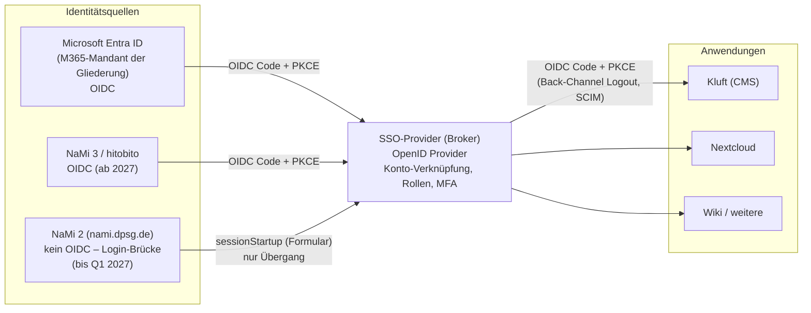

# Pflichtenheft: Single Sign-on für DPSG-Gliederungen (Microsoft 365 und NaMi)

**Stand:** 6. Oktober 2026 · **Status:** Entwurf zur Abstimmung · **Bezug:** Kluft (`docs/pflichtenheft.md`, `docs/mitgliederabgleich.md`, `docs/entscheidungen/anmeldung-ohne-m365.md`)

Dieses Pflichtenheft beschreibt einen zentralen Anmeldedienst („SSO-Provider“) für eine DPSG-Gliederung (Diözesanverband, Bezirk, Stamm). Ehrenamtliche und Hauptberufliche melden sich dort einmal an, entweder mit ihrem Microsoft-365-Konto der Gliederung oder mit ihrem NaMi-Zugang. Alle angebundenen Anwendungen bekommen dann eine geprüfte Identität mit Rollen, zum Beispiel Kluft, Nextcloud, Wiki oder Anmeldesysteme.

Anforderungen tragen IDs der Form `SSO-<Bereich>-<Nr>`. Die Verbindlichkeit richtet sich nach RFC 2119/8174:

| Begriff | Bedeutung |
|---|---|
| **MUSS** | Pflicht |
| **SOLL** | Pflicht, außer es gibt einen begründeten, dokumentierten Ausnahmefall |
| **KANN** | optional |

---

## Inhalt

1. [Ausgangslage und Ziel](#1-ausgangslage-und-ziel)
2. [Welcher Standard? (Ist das noch OpenID?)](#2-welcher-standard-ist-das-noch-openid)
3. [Begriffe](#3-begriffe)
4. [Systemkontext und Architektur](#4-systemkontext-und-architektur)
5. [Nutzergruppen und Rollen](#5-nutzergruppen-und-rollen)
6. [Funktionale Anforderungen](#6-funktionale-anforderungen)
7. [Anbindung Microsoft 365 / Entra ID](#7-anbindung-microsoft-365--entra-id)
8. [Anbindung NaMi 2 (nami.dpsg.de) – Schnittstellenbeschreibung](#8-anbindung-nami-2-namidpsgde--schnittstellenbeschreibung)
9. [Anbindung NaMi 3 (hitobito) – Schnittstellenbeschreibung](#9-anbindung-nami-3-hitobito--schnittstellenbeschreibung)
10. [Schnittstelle zu den Anwendungen (Claims-Vertrag)](#10-schnittstelle-zu-den-anwendungen-claims-vertrag)
11. [Nicht-funktionale Anforderungen](#11-nicht-funktionale-anforderungen)
12. [Datenschutz (KDG)](#12-datenschutz-kdg)
13. [Übergang NaMi 2 → NaMi 3](#13-übergang-nami-2--nami-3)
14. [Abnahme und Tests](#14-abnahme-und-tests)
15. [Umsetzungsoptionen (nicht bindend)](#15-umsetzungsoptionen-nicht-bindend)
16. [Offene Fragen](#16-offene-fragen)
17. [Quellen](#17-quellen)

---

## 1. Ausgangslage und Ziel

### 1.1 Ausgangslage

- **Microsoft 365 (Entra ID):** Hauptberufliche, Vorstände und Referent*innen vieler Diözesanverbände haben ein Konto im M365-Mandanten ihrer Gliederung. Kluft meldet die Redaktion heute nur darüber an (Single-Tenant, OIDC, `openid profile email`, Zuordnung über die Entra-Objekt-ID `oid`). Dazu gibt es einen lokalen Notfallzugang mit Passwort und TOTP.
- **NaMi:** Fast alle Leitenden haben einen Zugang zur Mitgliederverwaltung der DPSG. Die Rechte ergeben sich dort aus ihren Tätigkeiten.
  - **NaMi 2** (`nami.dpsg.de`) läuft laut DPSG bis Q1 2027. Danach ist sie nur noch lesbar und wird anschließend abgeschaltet.
  - **NaMi 3** basiert auf der Open-Source-Software hitobito; der Umstieg ist für Frühjahr 2027 angekündigt.
- **Viele Gliederungen haben keinen eigenen M365-Mandanten** (siehe `docs/entscheidungen/anmeldung-ohne-m365.md`). Für deren Ehrenamtliche ist NaMi das einzige Konto, das sie sicher haben.
- **Heute schon in Kluft:** Kluft prüft Teilnehmende gegen NaMi 2.
  - Jede Leitung meldet sich dafür mit dem eigenen NaMi-Zugang an.
  - Der Zugang kann freiwillig verschlüsselt im Profil gespeichert werden.
  - Die Schnittstellendetails dazu stehen in Kapitel 8.

### 1.2 Ziel

1. **Eine Anmeldung für alle Anwendungen der Gliederung**, mit Single Logout.
2. **Zwei gleichwertige Anmeldewege:** „Mit Microsoft 365 anmelden“ und „Mit NaMi anmelden“. Beide führen auf dieselbe Person, wenn sie verknüpft sind.
3. **Rollen kommen aus der Quelle:** Gruppen bzw. App-Rollen aus Entra ID, Tätigkeiten bzw. Rollen aus NaMi. Wer in NaMi ausscheidet, verliert automatisch den Zugang.
4. **Aktueller Standard (Kapitel 2):** Anwendungen binden sich nur noch per OpenID Connect an, Altsysteme ausnahmsweise per SAML.
5. **Zukunftssicher:** Der Wechsel NaMi 2 → NaMi 3 ist eine Konfigurationsänderung im SSO-Provider, keine Änderung in den Anwendungen.

### 1.3 Nicht-Ziele

- **Kein Ersatz für Entra ID oder NaMi:** Der SSO-Provider ist ein Vermittler (Identity Broker), keine neue Mitgliederverwaltung.
- **Keine Passwörter für Entra-Nutzende:** Für sie gibt es keine eigenen Passwörter im SSO-Provider.
- **Kein Mitgliederdaten-Spiegel:** Es werden nur die für die Anmeldung nötigen Merkmale gehalten.

---

## 2. Welcher Standard? (Ist das noch OpenID?)

**Ja.** Der maßgebliche Standard für Anmeldungen im Web ist 2026 **OpenID Connect (OIDC)** auf Basis von **OAuth 2.0**. OIDC Core 1.0 ist seit 2024 zusätzlich als **ISO/IEC 26131:2024** genormt. Die übrigen OIDC-Spezifikationen bilden die Reihe ISO/IEC 26131–26141.

Was „aktueller Standard“ im Einzelnen heißt und was der SSO-Provider daher abdecken muss:

| Thema | Stand Oktober 2026 | Folge für dieses Pflichtenheft |
|---|---|---|
| Anmeldung (Identität) | OpenID Connect Core 1.0 (ISO/IEC 26131:2024), Discovery 1.0, Dynamic Registration 1.0 (optional) | MUSS als OpenID Provider (OP) für die Anwendungen und als Relying Party (RP) gegenüber Entra und NaMi 3 |
| Autorisierung | OAuth 2.0 (RFC 6749) mit **Security BCP RFC 9700** (Januar 2025) | MUSS RFC 9700 einhalten |
| OAuth 2.1 | Internet-Draft (draft-ietf-oauth-v2-1-15, März 2026), Einreichung bei der IESG für Dezember 2026 geplant; fasst RFC 6749 + BCP zusammen | SOLL schon jetzt eingehalten werden: PKCE für alle Clients, kein Implicit Flow, kein Password Grant, exakte Redirect-URIs, Refresh-Token-Rotation oder -Bindung |
| PKCE | RFC 7636, Methode `S256` | MUSS für alle Clients (auch vertrauliche) |
| Absender-Bindung von Tokens | DPoP (RFC 9449), mTLS (RFC 8705) | SOLL DPoP anbieten; MUSS für Hochschutz-Profil |
| Pushed Authorization Requests | PAR (RFC 9126) | SOLL; MUSS im Hochschutz-Profil |
| Hochschutz-Profil | **FAPI 2.0 Security Profile** (Final, Februar 2025) | KANN für besonders schützenswerte Anwendungen (z. B. Mitgliederdaten-Export) |
| Abmeldung | OIDC RP-Initiated Logout 1.0, Back-Channel Logout 1.0, Front-Channel Logout 1.0 | MUSS RP-Initiated und Back-Channel; SOLL Front-Channel |
| Mix-up-Schutz | `iss`-Parameter in der Autorisierungsantwort (RFC 9207) | MUSS |
| Token-Formate | JWT (RFC 7519), JWT-Access-Tokens (RFC 9068), Introspection (RFC 7662), Revocation (RFC 7009) | MUSS Introspection und Revocation; SOLL RFC 9068 |
| Token-Tausch | Token Exchange (RFC 8693) | KANN (z. B. Anwendung ruft im Namen der Person eine API) |
| Phishing-resistente Anmeldung | **Passkeys / WebAuthn Level 3** (W3C) | MUSS für lokale Konten und Admins; SOLL als zweiter Faktor nach NaMi-Anmeldung |
| Provisionierung | **SCIM 2.0** (RFC 7643/7644) | SOLL ausgehend an Anwendungen, die es können (Nextcloud, Kluft später) |
| Sicherheitsereignisse | OpenID Shared Signals Framework (SSF) mit CAEP/RISC | KANN; Entra nutzt dafür eigene Mechanismen (Continuous Access Evaluation) |
| Altsysteme | SAML 2.0 Web Browser SSO | KANN nur für Anwendungen ohne OIDC |

Nicht mehr zeitgemäß und deshalb ausgeschlossen (SSO-STD-01, MUSS):
- **Implicit Flow**, auch `id_token token` aus der Adresszeile
- **Resource Owner Password Credentials Grant**: Ausnahme ist ausschließlich die NaMi-2-Brücke mit ihren Schutzauflagen, siehe 8.6
- **Tokens in URL-Parametern**
- **Platzhalter in Redirect-URIs**
- **Signaturalgorithmus `none`**
- **Symmetrische ID-Token-Signaturen** für öffentliche Clients

---

## 3. Begriffe

| Begriff | Bedeutung |
|---|---|
| SSO-Provider, Broker | Das zu beschaffende System. Für Anwendungen ist es OpenID Provider (OP), gegenüber Entra/NaMi 3 Relying Party (RP). |
| Upstream-IdP | Vorgelagerter Identitätsanbieter: Entra ID, NaMi 3 (hitobito), Sonderfall NaMi 2 (kein IdP, siehe 8). |
| Anwendung, Client, RP | Nachgelagerte Anwendung, die sich an den SSO-Provider bindet (Kluft, Nextcloud …). |
| Person | Ein Mensch im SSO-Provider; kann mehrere verknüpfte Konten (Entra, NaMi) haben. |
| Mitgliedsnummer | DPSG-Mitgliedsnummer (NaMi 2: `mitgliedsNummer`, auch Login-Name). Stabiler fachlicher Schlüssel über NaMi 2 und (voraussichtlich) NaMi 3. |
| Gliederungsnummer | DPSG-Nummer der Gruppierung, z. B. `21-01-08` (DV-Bezirk-Stamm); in NaMi 2 ohne Trennzeichen in der Gruppierungsbezeichnung (`… 210108`). |
| Tätigkeit | NaMi-2-Begriff für eine Funktion in einer Gruppierung (z. B. Leiter*in, Vorstand); Grundlage der Rechte. In NaMi 3: Rolle in einer Gruppe. |
| KDG | Gesetz über den Kirchlichen Datenschutz (gilt für die DPSG als katholischer Verband). |

---

## 4. Systemkontext und Architektur



Grundsätze:

- **SSO-ARC-01 (MUSS):** Anwendungen sprechen nur mit dem SSO-Provider, nie direkt mit Entra oder NaMi. Ein Wechsel der Quelle bleibt für Anwendungen unsichtbar.
- **SSO-ARC-02 (MUSS):** Der SSO-Provider ist mandantenfähig im Sinne von Kluft: eine Installation, je Gliederung ein eigener Bereich (Realm/Organisation) mit
  - eigenem Erscheinungsbild,
  - eigener Entra-Anbindung und eigenen Clients,
  - eigener Verwaltung.
  Eine NaMi-Anbindung SOLL mehrere Bereiche bedienen können.
- **SSO-ARC-03 (MUSS):** Eine Person ist an einem stabilen, quellunabhängigen Schlüssel festgemacht (interne UUID). Verknüpfte Konten werden über ihre unveränderlichen Quellschlüssel gespeichert:
  - Entra: `tid` + `oid`
  - NaMi 2: Mitgliedsnummer
  - NaMi 3: `iss` + `sub`
- **SSO-ARC-04 (MUSS):** Keine Anwendung erhält Passwörter. Das gilt auch für den NaMi-2-Sonderweg: Dort sieht nur der SSO-Provider das Passwort, siehe 8.6.

---

## 5. Nutzergruppen und Rollen

| Gruppe | Typischer Anmeldeweg | Bemerkung |
|---|---|---|
| Hauptberufliche, Vorstände mit M365 | Entra ID | MFA und Conditional Access des Mandanten gelten |
| Ehrenamtliche Leitende ohne M365 | NaMi (2, später 3) | Rechte aus Tätigkeiten/Rollen |
| Externe (Referent*innen, Gäste) | lokales Konto mit Passkey, ausnahmsweise | Nur auf Einladung, befristet |
| Administration des SSO-Providers | lokales Konto mit Passkey (Pflicht) **und** Entra | Mindestens zwei Personen; Notfallzugang gemäß SSO-ADM-05 |

Rollen im SSO-Provider (SSO-ROL-01, MUSS):
- **Instanz-Admin:** Betrieb, alle Bereiche
- **Bereichs-Admin:** eine Gliederung: Clients, Zuordnungsregeln, Personen
- **Prüfer\*in:** nur lesen, Audit-Log
- **Person:** Self-Service, siehe 6.6

---

## 6. Funktionale Anforderungen

### 6.1 OpenID Provider für Anwendungen

| ID | Anforderung | |
|---|---|---|
| SSO-OP-01 | Authorization Code Flow mit PKCE (`S256`) für vertrauliche und öffentliche Clients. | MUSS |
| SSO-OP-02 | Discovery unter `/.well-known/openid-configuration` je Bereich, JWKS mit Schlüsselrotation (alter Schlüssel bleibt mindestens 2× maximale Token-Lebensdauer veröffentlicht). | MUSS |
| SSO-OP-03 | Client-Authentisierung: `private_key_jwt` (RFC 7523) und `tls_client_auth`; `client_secret_basic` nur übergangsweise und mit mind. 256 Bit Zufall. | MUSS / SOLL |
| SSO-OP-04 | Exakter Vergleich der Redirect-URIs, nur `https` (Ausnahme `http://localhost` für Entwicklung, abschaltbar). | MUSS |
| SSO-OP-05 | `iss` in der Autorisierungsantwort (RFC 9207), `state` und `nonce` werden erzwungen. | MUSS |
| SSO-OP-06 | ID-Token signiert mit `ES256` oder `RS256`/`PS256`; Lebensdauer ≤ 5 min. | MUSS |
| SSO-OP-07 | Access-Token-Lebensdauer je Client einstellbar, Standard 10 min; Refresh-Tokens mit Rotation und Wiederverwendungserkennung (Familie widerrufen) oder DPoP-gebunden. | MUSS |
| SSO-OP-08 | UserInfo-Endpunkt, Introspection (RFC 7662), Revocation (RFC 7009). | MUSS |
| SSO-OP-09 | PAR (RFC 9126) und DPoP (RFC 9449); je Client erzwingbar. | SOLL |
| SSO-OP-10 | FAPI-2.0-Profil je Client aktivierbar. | KANN |
| SSO-OP-11 | Paarweise `sub` (Pairwise Subject Identifier) je Client einstellbar; Standard: paarweise. | MUSS |
| SSO-OP-12 | Scopes und Claims gemäß Kapitel 10; nur freigegebene Scopes je Client. | MUSS |
| SSO-OP-13 | Einwilligungsseite für Anwendungen außerhalb der Gliederung; für eigene Anwendungen abschaltbar (Vorab-Einwilligung durch Bereichs-Admin). | MUSS |
| SSO-OP-14 | `acr`/`amr` im ID-Token (z. B. `pwd`, `mfa`, `hwk`/`swk` für Passkey, Quelle `entra`/`nami2`/`nami3`); Anwendungen können per `acr_values` oder `max_age` eine stärkere bzw. frische Anmeldung verlangen (Step-up). | MUSS |
| SSO-OP-15 | SAML-2.0-IdP für Altanwendungen. | KANN |
| SSO-OP-16 | Device Authorization Grant (RFC 8628) für Geräte ohne Browser (z. B. Infoscreens). | KANN |

### 6.2 Anmeldung über die Quellen

| ID | Anforderung | |
|---|---|---|
| SSO-IDP-01 | Anmeldeseite je Bereich mit den freigeschalteten Wegen: „Mit Microsoft 365 anmelden“, „Mit NaMi anmelden“, ggf. „Mit Passkey anmelden“. | MUSS |
| SSO-IDP-02 | Entra ID als OIDC-Upstream gemäß Kapitel 7, mehrere Mandanten je Bereich möglich (Allowlist der `tid`). | MUSS |
| SSO-IDP-03 | NaMi 3 (hitobito) als OIDC-Upstream gemäß Kapitel 9. | MUSS (sobald verfügbar) |
| SSO-IDP-04 | NaMi-2-Login-Brücke gemäß Kapitel 8, nur bis zur Abschaltung von NaMi 2, je Bereich abschaltbar. | SOLL (Übergang) |
| SSO-IDP-05 | Startet eine Anwendung mit `login_hint` bzw. `idp_hint` (z. B. `entra`, `nami`), wird der passende Weg direkt gewählt. | SOLL |
| SSO-IDP-06 | Fehlermeldungen an Nutzende ohne interne Details (keine Antworttexte der Quelle, keine Mitgliedsnummern fremder Personen). | MUSS |

### 6.3 Personen und Konto-Verknüpfung

| ID | Anforderung | |
|---|---|---|
| SSO-ID-01 | Erstanmeldung legt eine Person an (Just-in-Time) **oder** ordnet einer vorab angelegten Person zu; je Bereich einstellbar, ob unbekannte Personen zugelassen sind oder „wartet auf Freischaltung“ erhalten (Kluft-Verhalten). | MUSS |
| SSO-ID-02 | Verknüpfen eines zweiten Kontos (z. B. NaMi zu bestehender Entra-Person) nur nach **erfolgreicher Anmeldung mit beiden Konten in derselben Sitzung**. | MUSS |
| SSO-ID-03 | **Keine automatische Verknüpfung über die E-Mail-Adresse.** Ausnahme: Bereichs-Admin erlaubt es ausdrücklich für verifizierte Adressen aus einer Domain-Allowlist (z. B. `@dpsg-trier.de`). | MUSS |
| SSO-ID-04 | Bereichs-Admins können Verknüpfungen einsehen, lösen und (mit Begründung, protokolliert) setzen. | MUSS |
| SSO-ID-05 | Stammdaten (Name, E-Mail) werden bei jeder Anmeldung aus der gerade genutzten Quelle aktualisiert; Vorrang je Attribut einstellbar (z. B. Name aus NaMi, E-Mail aus Entra). | SOLL |
| SSO-ID-06 | Die Mitgliedsnummer wird nur aus NaMi übernommen, nie von Nutzenden eingegeben oder aus Entra-Attributen gelesen (außer der Bereich pflegt sie dort bewusst, z. B. `employeeId`, und gibt das frei). | MUSS |

### 6.4 Rollen und Berechtigungen

| ID | Anforderung | |
|---|---|---|
| SSO-AZ-01 | Regelwerk je Bereich, das aus Quell-Merkmalen Rollen für Anwendungen ableitet; Beispiele: Entra-App-Rolle `Redaktion` → Rolle `kluft:redaktion`; NaMi-Tätigkeit „Vorsitzende*r“ in Gliederung `21-01-00` → Rolle `bezirk-trier:vorstand`. | MUSS |
| SSO-AZ-02 | Rollen werden bei jeder Anmeldung neu berechnet; zusätzlich periodische Prüfung (Standard täglich) für NaMi-Personen, sofern die Quelle es erlaubt (siehe 8.7, 9.5). | MUSS |
| SSO-AZ-03 | Fällt die Quelle als Begründung weg (Austritt, Tätigkeit beendet, Entra-Konto gesperrt), werden abgeleitete Rollen entzogen und laufende Sitzungen/Refresh-Tokens widerrufen (Back-Channel Logout an Anwendungen). | MUSS |
| SSO-AZ-04 | Manuell vergebene Zusatzrollen (befristet, mit Begründung) neben den abgeleiteten. | SOLL |
| SSO-AZ-05 | Gruppen an Anwendungen als Claim `groups`/`roles` und per SCIM-Gruppen. | MUSS / SOLL |

### 6.5 Mehr-Faktor-Anmeldung

| ID | Anforderung | |
|---|---|---|
| SSO-MFA-01 | Bei Entra-Anmeldung gilt die MFA des Mandanten; der SSO-Provider übernimmt `amr` aus dem Entra-ID-Token und kann per Regel `mfa` verlangen (sonst Ablehnung oder eigener zweiter Faktor). | MUSS |
| SSO-MFA-02 | Bei NaMi-2-Anmeldung (ohne MFA der Quelle) verlangt der SSO-Provider einen eigenen zweiten Faktor: Passkey (bevorzugt) oder TOTP (RFC 6238); je Bereich und je Anwendung erzwingbar. | MUSS |
| SSO-MFA-03 | Bei NaMi-3-Anmeldung: MFA der Quelle übernehmen, sofern im ID-Token ausgewiesen; sonst wie SSO-MFA-02. | MUSS |
| SSO-MFA-04 | Wiederherstellungscodes (einmalig, gehasht), Zurücksetzen durch Bereichs-Admin nur im Vier-Augen-Prinzip und protokolliert. | MUSS |
| SSO-MFA-05 | SMS als Faktor ist ausgeschlossen. | MUSS |

### 6.6 Self-Service

| ID | Anforderung | |
|---|---|---|
| SSO-SS-01 | Person sieht ihre verknüpften Konten, aktiven Sitzungen/Geräte, Einwilligungen und Faktoren und kann Sitzungen beenden, Einwilligungen widerrufen und Faktoren verwalten. | MUSS |
| SSO-SS-02 | Datenauskunft (KDG) als Download (JSON) für die eigene Person. | MUSS |
| SSO-SS-03 | Kein Passwort-Zurücksetzen für Entra/NaMi im SSO-Provider; stattdessen Links zu den Quellen (`https://nami.dpsg.de`, Microsoft-Kontoseite). | MUSS |

### 6.7 Sitzungen und Abmeldung

| ID | Anforderung | |
|---|---|---|
| SSO-SES-01 | SSO-Sitzung mit einstellbarer Leerlauf- (Standard 2 h) und Höchstdauer (Standard 12 h; „angemeldet bleiben“ max. 30 Tage, nicht für Admins). | MUSS |
| SSO-SES-02 | RP-Initiated Logout (mit `id_token_hint`, `post_logout_redirect_uri` exakt registriert) und Back-Channel Logout an alle Anwendungen der Sitzung. | MUSS |
| SSO-SES-03 | Abmeldung beim Upstream: Entra per `end_session_endpoint` (optional, je Bereich), NaMi 2 per Logout-Aufruf bzw. Verwerfen der Session (siehe 8.4), NaMi 3 per `end_session_endpoint`. | SOLL |
| SSO-SES-04 | Sitzungs-Cookies `Secure`, `HttpOnly`, `SameSite=Lax` (bzw. `None` nur wo für Logout zwingend), Präfix `__Host-`. | MUSS |

### 6.8 Verwaltung, Protokoll, Provisionierung

| ID | Anforderung | |
|---|---|---|
| SSO-ADM-01 | Web-Oberfläche je Bereich: Clients (Redirect-URIs, Scopes, Schlüssel), Upstream-Anbindungen, Rollenregeln, Personen, Verknüpfungen, Sperren. | MUSS |
| SSO-ADM-02 | Konfiguration zusätzlich als Code (Export/Import, z. B. YAML/Terraform), versionierbar. | SOLL |
| SSO-ADM-03 | Audit-Log aller sicherheitsrelevanten Ereignisse (Anmeldung ok/fehlgeschlagen mit Quelle, Verknüpfen/Lösen, Rollenänderung, Admin-Aktionen, Schlüsselwechsel), unveränderbar, Aufbewahrung 12 Monate, Export an SIEM (Syslog/JSON). | MUSS |
| SSO-ADM-04 | SCIM-2.0-Client: Personen und Gruppen an Anwendungen übertragen und bei Wegfall deaktivieren. | SOLL |
| SSO-ADM-05 | Notfallzugang („Break-Glass“) je Instanz: zwei lokale Konten mit Hardware-Passkey, nicht an Entra/NaMi gebunden, Nutzung löst Benachrichtigung aus. | MUSS |
| SSO-ADM-06 | Benachrichtigungen (E-Mail, optional ntfy) bei: Notfallzugang genutzt, viele Fehlanmeldungen, Upstream nicht erreichbar, Schlüssel läuft ab. | SOLL |
| SSO-ADM-07 | Statusseite/Health-Endpunkt je Upstream mit Ampel (erreichbar, Anmeldung ok, Zertifikat/Secret-Ablauf), vergleichbar der NaMi-Ampel in Kluft. | SOLL |

---

## 7. Anbindung Microsoft 365 / Entra ID

### 7.1 Protokoll und Endpunkte

Entra ID ist ein vollständiger OpenID Provider (Microsoft identity platform, v2.0-Endpunkte):

| Zweck | URL |
|---|---|
| Discovery | `https://login.microsoftonline.com/{tenant-id}/v2.0/.well-known/openid-configuration` |
| Autorisierung | `https://login.microsoftonline.com/{tenant-id}/oauth2/v2.0/authorize` |
| Token | `https://login.microsoftonline.com/{tenant-id}/oauth2/v2.0/token` |
| Abmeldung | `https://login.microsoftonline.com/{tenant-id}/oauth2/v2.0/logout` |
| JWKS | aus Discovery (`jwks_uri`) |
| Graph (optional) | `https://graph.microsoft.com/v1.0` |

- **SSO-ENT-01 (MUSS):** Je Gliederung eine App-Registrierung im eigenen Mandanten, **Single-Tenant** (`{tenant-id}` statt `common`/`organizations`). Mehrere Mandanten (z. B. DV und Bezirk mit eigenem M365) werden als getrennte Upstreams mit eigener `tid`-Allowlist angebunden. `common` ist ausgeschlossen (siehe `anmeldung-ohne-m365.md`, Option B).
- **SSO-ENT-02 (MUSS):** Authorization Code Flow mit PKCE; Client-Authentisierung per **Zertifikat** (`private_key_jwt`) oder **Federated Identity Credential**; ein Client-Secret nur übergangsweise mit Ablaufüberwachung.
- **SSO-ENT-03 (MUSS):** Scopes `openid profile email` und, falls Gruppen über Graph gelesen werden, `GroupMember.Read.All` als delegierte Berechtigung (Admin-Zustimmung).
- **SSO-ENT-04 (MUSS):** ID-Token-Prüfung:
  - Signatur gegen JWKS
  - `iss` passend zur `tid`
  - `aud` = Client-ID
  - `tid` in der Allowlist
  - `nonce`
  - `exp`/`iat` mit höchstens 5 min Uhrzeittoleranz

### 7.2 Merkmale (Claims)

| Claim | Verwendung | Hinweis |
|---|---|---|
| `tid` + `oid` | **Unveränderlicher Schlüssel** des Entra-Kontos | `sub` ist bei Entra je Anwendung paarweise und taugt nicht als mandantenweiter Schlüssel |
| `preferred_username` | Anzeige, `login_hint` | Veränderlich, **nicht** für Zuordnung oder Rechte verwenden |
| `email` | E-Mail-Adresse | Optionaler Claim, nicht zwingend verifiziert; nur mit Domain-Allowlist vertrauen |
| `name`, `given_name`, `family_name` | Anzeige | `given_name`/`family_name` ggf. als optionale Claims konfigurieren |
| `roles` | App-Rollen der App-Registrierung | **Bevorzugter Weg** für Rollen (SSO-AZ-01) |
| `groups` | Gruppen-IDs | Nur mit Bedacht: Bei vielen Gruppen kommt statt der Liste ein Überlauf-Hinweis (`_claim_names`/`hasgroups`), dann Graph nötig; besser „nur der Anwendung zugewiesene Gruppen“ oder App-Rollen |
| `amr`, `acrs` | Anmeldeart, Authentication Context (Conditional Access) | Für SSO-MFA-01 und Step-up |
| `employeeId`, Erweiterungsattribute | KANN die Mitgliedsnummer tragen | Nur wenn die Gliederung das pflegt (SSO-ID-06) |

- **SSO-ENT-05 (SOLL):** Conditional Access der Gliederung (MFA, Gerätebedingungen) bleibt wirksam; der SSO-Provider kann per Authentication Context (`acrs`) gezielt stärkere Anmeldung anfordern.
- **SSO-ENT-06 (SOLL):** Deaktivierte oder gelöschte Entra-Konten werden erkannt, entweder über Graph-Abfrage beim Refresh, periodisch oder per Änderungsbenachrichtigung (Graph Change Notifications/Delta-Query). Die Folge ist dann SSO-AZ-03.
- **SSO-ENT-07 (KANN):** Gäste (B2B) im Mandanten werden wie Mitglieder behandelt, aber nur, wenn der Bereich das freischaltet (`acct`-Claim bzw. `userType`).

### 7.3 Kein Passwort-Grant

Der Resource Owner Password Credentials Grant ist bei Entra **ausgeschlossen**, auch zu Testzwecken: Er umgeht MFA und Conditional Access und wird von Microsoft nicht empfohlen.

---

## 8. Anbindung NaMi 2 (nami.dpsg.de) – Schnittstellenbeschreibung

> **Wichtig:** NaMi 2 hat **kein** OAuth/OIDC und **keine offizielle, öffentlich dokumentierte API**. Die folgende Beschreibung beruht auf drei Quellen:
> - der in Kluft gebauten und getesteten Anbindung (`app/Services/Mitglieder/NamiVerzeichnis.php`)
> - dem Quellcode der NaMi-App der DPSG-Community (`digital-scouts/dpsg-nami-app`)
> - der Python-Bibliothek `pynami`
>
> Sie ist vor der Umsetzung gegen das Echtsystem zu prüfen. NaMi 2 läuft laut DPSG (ncm.dpsg.de, Update #6) bis Q1 2027, danach nur lesend und dann gar nicht mehr.

### 8.1 Grunddaten

| Merkmal | Wert |
|---|---|
| Basis-URL | `https://nami.dpsg.de` |
| REST-Wurzel | `/ica/rest` |
| Service-Pfad (versioniert, aktuell) | `/ica/rest/api/1/1/service/nami` (so in der NaMi-App und in Kluft; konfigurierbar halten, Kluft: `NAMI_URL`, `NAMI_PATH`) |
| Service-Pfad (älter, weiterhin erreichbar) | `/ica/rest/nami` (so in `pynami`) |
| Formate | Anfrage: `application/x-www-form-urlencoded` (Anmeldung) bzw. Query-Parameter/JSON; Antwort: JSON |
| Sitzung | Cookie `JSESSIONID`, Pfad `/ica`, serverseitige Sitzung mit Zeitablauf |
| Konten | Persönliche Konten: Login-Name = **Mitgliedsnummer**, eigenes Passwort; Rechte aus den Tätigkeiten der Person |
| MFA | keine |

### 8.2 Anmeldung (sessionStartup)

```http
POST /ica/rest/api/1/1/service/nami/auth/manual/sessionStartup HTTP/1.1
Host: nami.dpsg.de
Origin: https://nami.dpsg.de
Content-Type: application/x-www-form-urlencoded
Accept: application/json

username=<Mitgliedsnummer>&password=<Passwort>&Login=API
```

Antwort und Auswertung:
- **Weiterleitung:** Der Server antwortet mit `200` oder mit `302` und Weiterleitung. Die NaMi-App folgt der `Location` und erzwingt dabei `https`.
- **Erfolg:** HTTP 200, ein `Set-Cookie: JSESSIONID=…; Path=/ica` und ein JSON-Körper mit `statusCode: 0` und leerem `statusMessage`, etwa:
  ```json
  { "statusCode": 0, "statusMessage": "", "apiSessionName": "JSESSIONID", "apiSessionToken": "…", "majorNumber": 1, "minorNumber": 1 }
  ```
  `apiSessionName`, `apiSessionToken` und die Versionsnummern stammen aus Community-Beschreibungen. Ausgewertet werden SOLLEN nur `statusCode`, `statusMessage` und das Cookie.
- **Misserfolg:** `statusCode ≠ 0` (beobachtet z. B. `3000`) und eine Meldung in `statusMessage`, etwa „Benutzer … unbekannt“. Diese Meldung kann die Mitgliedsnummer enthalten. Deshalb gilt:
  - **SSO-N2-01 (MUSS):** Antworttexte der NaMi weder protokollieren noch anzeigen; nur „Anmeldung fehlgeschlagen“ ausgeben.
- **Fehler der Verbindung:** Zeitüberschreitung oder 5xx sind als „NaMi nicht erreichbar“ zu werten, nicht als „Passwort falsch“. Fehlversuchszähler dürfen dann nicht erhöht werden.

### 8.3 Abfragen mit der Sitzung (Auswahl)

Alle Aufrufe mit `Cookie: JSESSIONID=…`. Erfolgreiche Antworten haben die Form `{ "success": true, "data": … , "totalEntries": n }`. Fehler kommen als `{ "success": false, "message": "…" }`.

Abkürzung `{S}` = Service-Pfad aus 8.1. Platzhalter: `{gid}` = interne Gruppierungs-ID, `{mid}` = interne Mitglieds-ID (nicht die Mitgliedsnummer).

| Zweck | Methode und Pfad | Für SSO nötig? |
|---|---|---|
| Abmelden | `GET {S}/auth/logout` (in `pynami` unter `/ica/rest/nami/auth/logout`) | ja (Sitzung verwerfen) |
| Für die angemeldete Person zugängliche Gruppierungen | `GET {S}/gf/gruppierung` | ja (Zuordnung zur Gliederung) |
| Gruppierungsbaum | `GET {S}/gruppierungen/filtered-for-navigation/gruppierung/node/{gid}` (`node=1` = Wurzel; rekursiv bis zu Blättern) | optional |
| Suche über mehrere Merkmale | `GET {S}/search-multi/result-list?searchedValues=<JSON>&page=1&start=0&limit=50` | ja (eigene Person, siehe 8.5) |
| Mitglieder einer Gruppierung | `GET {S}/mitglied/filtered-for-navigation/gruppierung/gruppierung/{gid}/flist?page=1&start=0&limit=…` | nein |
| Einzelnes Mitglied | `GET {S}/mitglied/filtered-for-navigation/gruppierung/gruppierung/{gid}/{mid}` | optional |
| Tätigkeiten eines Mitglieds | `GET {S}/zugeordnete-taetigkeiten/filtered-for-navigation/gruppierung-mitglied/mitglied/{mid}/flist` | ja (Rollen, SSO-AZ-01) |
| Ausbildungen eines Mitglieds | `GET {S}/mitglied-ausbildung/filtered-for-navigation/mitglied/mitglied/{mid}/flist` | nein |
| Rechte der angemeldeten Person | `GET /ica/pages/rights/ShowRights?gruppierung={gid}&id={Mitgliedsnummer}` (HTML-Seite, nur per Auslesen der Seite) | optional; antwortet bei abgelaufener Sitzung mit HTTP 500 |
| Dashboard-Statistik | `GET /ica/rest/dashboard/stats/stats` | nein |
| Eigene Führungszeugnis-Bescheinigungen | `GET /ica/rest/nami/fz/eigene-bescheinigungen/flist?page=1&start=0&limit=15` | nein (Hinweis: Leitende holen die Bescheinigung für das erweiterte Führungszeugnis hier) |
| Stammdaten-Listen | `GET /ica/rest/baseadmin/{geschlecht\|staatsangehoerigkeit\|region\|land\|konfession}/`, `GET /ica/rest/nami/enum/mgltype/` | nein |
| Schreibende Aufrufe (Mitglied anlegen/ändern, Tätigkeit anlegen/ändern/löschen, Mitgliedschaft beenden) | `POST/PUT/DELETE` unter `{S}/mitglied/…`, `{S}/zugeordnete-taetigkeiten/…`, `{S}/mitglied/filtered-for-navigation/mglschaft-beenden` | **nein – der SSO-Provider darf nicht schreiben (SSO-N2-02, MUSS)** |

### 8.4 Sitzungsablauf und Fehlerbehandlung

- **Ablauf:** Sitzungen laufen serverseitig nach einiger Zeit ab. Die genaue Dauer ist nicht dokumentiert; erfahrungsgemäß liegt sie im Bereich von Minuten bis wenigen Stunden.
- **Erkennen:** Eine abgelaufene Sitzung zeigt sich durch eine dieser Antworten:
  - HTTP 401
  - `{ "success": false, "message": "…Session…" }`
  - beim Rechte-Dokument HTTP 500
- **SSO-N2-03 (MUSS):** Die Login-Brücke nutzt die NaMi-Sitzung nur während der Anmeldung, höchstens 60 s. Danach meldet sie ab (8.3) und verwirft das Cookie. Für Anwendungen ist ausschließlich die Sitzung des SSO-Providers maßgeblich.
- **SSO-N2-04 (MUSS):** Gleichzeitige Anmeldungen derselben Person dürfen sich nicht gegenseitig die NaMi-Sitzung entwerten. Erfahrung aus der NaMi-App: Neuanmeldungen werden je Person serialisiert.
- **SSO-N2-05 (MUSS):** Zeitüberschreitung je Aufruf ≤ 20 s. Bei Störung zeigt der SSO-Provider „NaMi ist gerade nicht erreichbar“ und bietet die anderen Anmeldewege an.

### 8.5 Eigene Person ermitteln (Merkmale für die Anmeldung)

Nach erfolgreichem `sessionStartup` ist die Mitgliedsnummer bekannt, denn sie ist der Login-Name. Name, Gruppierung und Status liefert die Suche nach genau dieser Nummer:

```http
GET {S}/search-multi/result-list?searchedValues=<url-codiertes JSON>&page=1&start=0&limit=10
```

`searchedValues` muss **alle** Felder enthalten. Fehlende Felder führen erfahrungsgemäß zu Fehlern. Gesucht wird nur über `mitgliedsNummber`, mit **doppeltem „b“**, so in der API:

```json
{
  "vorname": "", "nachname": "", "spitzname": "",
  "mitgliedsNummber": "<Mitgliedsnummer>",
  "mglWohnort": "", "alterVon": "", "alterBis": "",
  "mglStatusId": null, "mglTypeId": [], "organisation": "",
  "tagId": [], "bausteinIncludedId": [], "zeitschriftenversand": false,
  "searchName": "", "taetigkeitId": [], "untergliederungId": [],
  "mitAllenTaetigkeiten": false, "withEndedTaetigkeiten": false,
  "ebeneId": null, "grpNummer": "", "grpName": "",
  "gruppierung1Id": null, "gruppierung2Id": null, "gruppierung3Id": null,
  "gruppierung4Id": null, "gruppierung5Id": null, "gruppierung6Id": null,
  "inGrp": false, "unterhalbGrp": false
}
```

Felder je Treffer in `data[]`, wie sie Kluft und die NaMi-App auswerten:

| Feld | Bedeutung | Beispiel/Format |
|---|---|---|
| `id` | interne Mitglieds-ID (`{mid}`) | `123456` |
| `entries_mitgliedsNummer` | Mitgliedsnummer | `4711` (ggf. mit führenden Nullen vergleichen) |
| `entries_vorname`, `entries_nachname` | Name | |
| `entries_email` | E-Mail (falls gepflegt) | nicht verifiziert |
| `entries_geburtsDatum` | Geburtsdatum | `2010-03-03 00:00:00` |
| `entries_gruppierung` | Gruppierung als Text **mit Gliederungsnummer** | `… St. Konrad 210108` → `21-01-08` |
| `entries_status` | Mitgliedschaftsstatus | `Aktiv` / `Inaktiv` |
| `entries_mglType` | Art | `Mitglied`, `Nicht-Mitglied` (z. B. Kontakte) |

- **SSO-N2-06 (MUSS):** Die Anmeldung gilt nur, wenn ein Treffer mit genau dieser Mitgliedsnummer existiert und `entries_status = Aktiv` gilt. Für Leitende verlangen Rollenregeln zusätzlich `entries_mglType = Mitglied`. Inaktive Personen werden abgewiesen, außer der Bereich lässt sie ausdrücklich zu.
- **SSO-N2-07 (MUSS):** Die Gliederungsnummer wird aus `entries_gruppierung` gelesen (Muster `\b(\d{2})(\d{2})(\d{2})\b` → `DD-BB-SS`). Daraus wird der Bereich der Person abgeleitet. Ohne Treffer zählt der Name als Rückfall.

### 8.6 Sicherheitsauflagen für die Login-Brücke

NaMi 2 bietet nur die Anmeldung mit Nutzername und Passwort. Die Brücke ist damit faktisch ein Password Grant und **nur als Übergang zulässig**. Auflagen:

| ID | Auflage | |
|---|---|---|
| SSO-N2-08 | Das NaMi-Passwort wird nur im Arbeitsspeicher der Anfrage verarbeitet; **nie gespeichert, protokolliert oder an Anwendungen weitergegeben** (auch nicht verschlüsselt). | MUSS |
| SSO-N2-09 | Eigene Anmeldemaske des SSO-Providers mit klarem Hinweis „Anmeldung mit deinem NaMi-Zugang; das Passwort wird nur an nami.dpsg.de weitergegeben und nicht gespeichert“. | MUSS |
| SSO-N2-10 | Schutz gegen Durchprobieren: Ratenbegrenzung je Mitgliedsnummer (z. B. 5 Fehlversuche / 15 min) und je IP; kein Unterschied in Antwort und Antwortzeit zwischen „unbekannt“ und „Passwort falsch“; CAPTCHA erst nach Fehlversuchen. | MUSS |
| SSO-N2-11 | Zweiter Faktor des SSO-Providers verpflichtend für alle Rollen mit Zugriff auf personenbezogene Daten (SSO-MFA-02). | MUSS |
| SSO-N2-12 | Ausgehende Verbindung nur zu `nami.dpsg.de` über TLS ≥ 1.2 mit Zertifikatsprüfung, keine Weiterleitung auf fremde Hosts (Weiterleitungsziel prüfen). | MUSS |
| SSO-N2-13 | Vor Inbetriebnahme schriftliche Klärung mit der DPSG-Bundesebene (Nutzungsbedingungen NaMi, Belastung, Ansprechpartner bei Störungen). | MUSS |
| SSO-N2-14 | Abschaltdatum konfigurierbar; die Brücke deaktiviert sich zum Stichtag und verweist auf NaMi 3. | SOLL |

### 8.7 Rollen aus NaMi 2

- **Quelle der Tätigkeiten:** `{S}/zugeordnete-taetigkeiten/…/mitglied/{mid}/flist`. Die Felder sind gegen das Echtsystem festzustellen; laut `pynami` sind es unter anderem:
  - Tätigkeit
  - Gruppierung
  - Untergliederung (Stufe)
  - Beginn und Ende
- **SSO-N2-15 (MUSS):** Nur laufende Tätigkeiten zählen; das Ende liegt also leer oder in der Zukunft.
- **SSO-N2-16 (SOLL):** Rollenregeln für NaMi-2-Tätigkeiten und NaMi-3-Rollen in einer gemeinsamen fachlichen Liste pflegen, z. B. `vorstand`, `leitung:woelflinge`, `kasse`. So bleiben die Regeln beim Umstieg gleich (Kapitel 13).
- **Periodische Prüfung (SSO-AZ-02):** Mit NaMi 2 ist sie nur während einer Anmeldung möglich, weil keine Hintergrund-Zugangsdaten gespeichert werden (SSO-N2-08). Gültigkeit abgeleiteter Rollen ohne erneute Anmeldung daher höchstens 30 Tage (SOLL), danach erneute NaMi-Anmeldung.

---

## 9. Anbindung NaMi 3 (hitobito) – Schnittstellenbeschreibung

NaMi 3 basiert auf **hitobito** (Open Source, AGPL), mit DPSG-spezifischen Erweiterungen (`hitobito_dpsg` bzw. `hitobito_pfadi_de`). hitobito ist selbst ein **OAuth-2.0- und OpenID-Connect-Provider** (Ruby-Gem Doorkeeper mit doorkeeper-openid_connect). Der Anschluss erfolgt deshalb standardkonform als OIDC-Upstream. Die Angaben unten folgen der hitobito-Entwicklerdokumentation (`doc/developer/people/oauth.md`, `config/settings.yml`, `config/initializers/doorkeeper*.rb`). Werte der DPSG-Instanz sind mit ihrer Discovery zu prüfen.

### 9.1 Endpunkte

| Zweck | Pfad (relativ zur NaMi-3-Adresse, z. B. `https://<nami3>`) |
|---|---|
| Discovery | `/.well-known/openid-configuration` |
| Autorisierung | `/oauth/authorize` |
| Token | `/oauth/token` |
| UserInfo (OIDC) | `/oauth/userinfo` |
| Profil (OAuth, Header `X-Scope: <scope>`) | `/oauth/profile` |
| Abmeldung | `end_session_endpoint` aus Discovery |
| JSON:API (Personen, Gruppen, Rollen …) | `/api/…` (z. B. `/api/people`), Content-Type `application/vnd.api+json` |

### 9.2 Registrierung und Flüsse

- **Anwendungen anlegen:** Das dürfen nur **Admins der obersten Ebene** (bei der DPSG: Bundesebene). Sie vergeben Client-ID (UID) und Secret, erlaubte Redirect-URIs (nur `https`) und erlaubte Scopes.
  - **SSO-N3-01 (MUSS):** Je Gliederung oder zentral für alle Gliederungen beantragen. Die Entscheidung trifft die DPSG, siehe Kapitel 16.
- **Grant-Flows der Standardinstallation:** `authorization_code` und `implicit_oidc`.
  - **SSO-N3-02 (MUSS):** Der SSO-Provider nutzt ausschließlich `authorization_code`, mit PKCE (`S256`), soweit die Instanz es annimmt (Doorkeeper unterstützt PKCE).
- **Lebensdauern (Standard hitobito):**

  | Token | Lebensdauer |
  |---|---|
  | Access-Token | 2 h |
  | Refresh-Token | 7 Tage, einmal verwendbar (Rotation) |
  | ID-Token | 2 min |
  | Signatur | RSA (JWT_SIGNING_KEY) |

- **`sub`:** `public`, nämlich die interne Personen-ID von hitobito.
  - **SSO-N3-03 (MUSS):** Schlüssel des NaMi-3-Kontos ist `iss` + `sub`, nicht die E-Mail.

### 9.3 Scopes

| Scope | Liefert |
|---|---|
| `openid` | ID-Token, UserInfo |
| `email` | `id`, `email` (Standard-Scope) |
| `name` | `id`, `email`, Vor-/Nachname, Pfadiname (`nickname`) |
| `with_roles` | alle öffentlichen Profilangaben **und Rollen**: je Rolle `group_id`, `group_name`, `role`/`role_class`, `role_name`, `permissions` (z. B. `layer_and_below_full`) |
| `api` | Zugriff auf alle JSON:API-Endpunkte im Namen der Person |
| `people`, `groups`, `events`, `invoices`, `mailing_lists` | einzelne API-Bereiche |
| `nextcloud` | Nextcloud-Gruppen aus den Rollen |

- **SSO-N3-04 (MUSS):** Für die Anmeldung reichen `openid email name with_roles`. `api` und die einzelnen API-Scopes werden **nicht** angefordert (Datensparsamkeit).

Beispiel UserInfo mit `with_roles` (gekürzt):

```json
{
  "sub": "34",
  "email": "julia@example.com",
  "first_name": "Julia", "last_name": "Keller", "nickname": "Polka",
  "birthday": "1999-09-09", "primary_group_id": 1,
  "roles": [
    { "group_id": 1, "group_name": "…", "role_class": "Group::Bund::MitarbeiterGs",
      "role_name": "Mitarbeiter*in GS", "permissions": ["layer_and_below_full"] }
  ]
}
```

### 9.4 Merkmale und Mitgliedsnummer

- **Mitgliedsnummer:** Wie die bisherige Mitgliedsnummer in NaMi 3 abgebildet wird (eigenes Attribut, Personen-ID, Profilfeld), legt die DPSG noch fest.
  - **SSO-N3-05 (MUSS):** Die Zuordnung ist konfigurierbar, entsprechend Kluft `HITOBITO_MEMBER_NUMBER_ATTRIBUTE`.
  - Laut DPSG bleibt die Nummer erhalten; der Stammeswechsel läuft weiter über „Mitgliedsnummer und Geburtsdatum“.
- **Gliederung:** Rollen enthalten `group_id`/`group_name`. Die DPSG-Gliederungsnummer kommt aus den Gruppenattributen der DPSG-Erweiterung.
  - **SSO-N3-06 (SOLL):** Abbildung `group_id` → Gliederungsnummer über die JSON:API (`/api/groups`) mit einem Service-Token der Gliederung, zwischengespeichert.
- **Austritt:** Ein Austritt (`exit_date`) beendet die Rollen. **SSO-N3-07 (MUSS):** Personen ohne laufende Rolle in der Gliederung erhalten keine abgeleiteten Rollen.

### 9.5 Hintergrundabgleich (optional)

- **SSO-N3-08 (KANN):** Für SSO-AZ-02 nutzt der SSO-Provider die JSON:API mit einem **Service-Token** der Gliederung, damit Austritte auch ohne erneute Anmeldung wirken.
  - **Header:** `X-TOKEN: <token>`
  - **Rechte:** „Personen dieser und der darunterliegenden Ebenen“, nur lesen
  - Der Service-Token wird von einer Person mit Leitungsrechten auf der Ebene unter „API-Keys“ angelegt.
- Alternativ: Refresh-Token der Person nutzen (gültig 7 Tage). Danach muss sich die Person neu anmelden.

---

## 10. Schnittstelle zu den Anwendungen (Claims-Vertrag)

Der SSO-Provider liefert allen Anwendungen einheitliche Merkmale, unabhängig vom Anmeldeweg (SSO-OP-12, MUSS):

| Scope | Claims | Herkunft |
|---|---|---|
| `openid` | `sub` (paarweise je Client), `iss`, `aud`, `exp`, `iat`, `auth_time`, `nonce`, `acr`, `amr`, `sid` | SSO-Provider |
| `profile` | `name`, `given_name`, `family_name`, `nickname` (Pfadiname), `locale` | Entra/NaMi gemäß SSO-ID-05 |
| `email` | `email`, `email_verified` (nur `true`, wenn aus Entra mit Domain-Allowlist bzw. vom SSO-Provider selbst bestätigt) | Entra/NaMi |
| `dpsg` | `dpsg_mitgliedsnummer` (nur wenn aus NaMi), `dpsg_gliederung` (z. B. `21-01-08`), `dpsg_gliederung_name`, `dpsg_status` (`aktiv`/`inaktiv`/`gast`) | NaMi |
| `roles` | `roles`: Liste der für **diesen Client** abgeleiteten Rollen (SSO-AZ-01), z. B. `["redaktion", "veranstaltungen:dv"]` | Regelwerk |
| `idp` | `idp`: genutzter Anmeldeweg (`entra`, `nami2`, `nami3`, `local`) | SSO-Provider |

Regeln:
- **SSO-CL-01 (MUSS):** Anwendungen erhalten nur die Scopes, die für sie freigegeben sind. `dpsg` braucht eine eigene Freigabe je Client.
- **SSO-CL-02 (MUSS):** Keine Geburtsdaten, Adressen oder Rollen anderer Gliederungen an Anwendungen. Ausnahme: ausdrücklich freigegebene Einzelfälle mit Zweckbindung.
- **SSO-CL-03 (SOLL):** Für Kluft entfällt damit die eigene Entra-Anbindung (`EntraAuthController`). Kluft bindet sich als OIDC-Client an. Die Zuordnung bestehender Konten (`entra_oid`) erfolgt einmalig über den Claim `idp`/Verknüpfungsliste.

---

## 11. Nicht-funktionale Anforderungen

### 11.1 Sicherheit

| ID | Anforderung | |
|---|---|---|
| SSO-SEC-01 | Ausrichtung an BSI IT-Grundschutz (Bausteine ORP.4 Identitäts- und Berechtigungsmanagement, APP.3.1 Webanwendungen) und OWASP ASVS 4.0 Stufe 2 (Admin-Bereich Stufe 3). | MUSS |
| SSO-SEC-02 | TLS 1.3 (1.2 nur mit BSI-TR-02102-2-konformen Suiten), HSTS mit `preload`, CSP ohne `unsafe-inline` auf Anmeldeseiten, `frame-ancestors 'none'`. | MUSS |
| SSO-SEC-03 | Signaturschlüssel in HSM/KMS oder mindestens verschlüsselt mit getrenntem Schlüssel; automatische Rotation (Standard 90 Tage) mit Überlappung. | MUSS |
| SSO-SEC-04 | Geheimnisse (Client-Secrets, Service-Tokens) nur verschlüsselt gespeichert, nie im Klartext in Logs; Ablaufüberwachung mit Vorwarnung (30/7 Tage). | MUSS |
| SSO-SEC-05 | Schutz vor CSRF, Clickjacking, Open Redirect, Session Fixation; Brute-Force-Schutz auf allen Anmeldewegen. | MUSS |
| SSO-SEC-06 | Jährlicher Penetrationstest vor und nach größeren Änderungen; Schwachstellen-Scan der Abhängigkeiten in der CI. | SOLL |
| SSO-SEC-07 | Software mit aktiver Sicherheitspflege (Sicherheitsupdates ≤ 14 Tage nach Veröffentlichung eingespielt, kritische ≤ 72 h). | MUSS |

### 11.2 Betrieb

| ID | Anforderung | |
|---|---|---|
| SSO-OPS-01 | Hosting in der EU (bevorzugt Deutschland), Auftragsverarbeitungsvertrag nach KDG. | MUSS |
| SSO-OPS-02 | Verfügbarkeit 99,5 % im Jahresmittel; geplante Wartung angekündigt. Fällt eine Quelle aus, bleiben die anderen Anmeldewege nutzbar. | MUSS |
| SSO-OPS-03 | Tägliche verschlüsselte Sicherung, 14 Tage Aufbewahrung, dokumentierte und jährlich geprobte Wiederherstellung. | MUSS |
| SSO-OPS-04 | Monitoring: Erreichbarkeit, Anmeldeerfolg je Quelle, Fehlerquote, Zertifikats-/Secret-Ablauf (siehe SSO-ADM-07). | MUSS |
| SSO-OPS-05 | Antwortzeit Anmeldeseite < 1 s (95. Perzentil) ohne Upstream; Gesamtanmeldung abhängig von Entra/NaMi. | SOLL |
| SSO-OPS-06 | Betrieb durch Ehrenamtliche möglich: Updates ohne Ausfallzeit oder mit < 5 min, Dokumentation auf Deutsch. | SOLL |

### 11.3 Bedienbarkeit

| ID | Anforderung | |
|---|---|---|
| SSO-UX-01 | Anmelde- und Self-Service-Seiten barrierefrei nach BITV 2.0 / WCAG 2.2 AA. | MUSS |
| SSO-UX-02 | Erscheinungsbild je Gliederung (Logo, Farben nach DPSG-CD, Texte), Sprache Deutsch, optional Englisch/Französisch. | MUSS / KANN |
| SSO-UX-03 | Einfache Sprache auf der Anmeldeseite; klare Hinweise, welcher Weg für wen gedacht ist („Hauptberuflich oder mit M365-Konto der Gliederung“ / „Mit deinem NaMi-Zugang“). | MUSS |
| SSO-UX-04 | Mobil nutzbar; Passkeys auf gängigen Smartphones. | MUSS |

---

## 12. Datenschutz (KDG)

- **Verantwortlich:** Die jeweilige Gliederung bzw. ihr Rechtsträger. Der Betreiber ist Auftragsverarbeiter (§ 29 KDG).
- **Zweck und Rechtsgrundlage:** Anmeldung und Berechtigungsprüfung für Anwendungen der Gliederung. Rechtsgrundlage ist die Erforderlichkeit für die Tätigkeit in der Gliederung bzw. für das Beschäftigungsverhältnis. Die Rechtsgrundlage ist im Verzeichnis der Verarbeitungstätigkeiten festzuhalten.
- **Gespeicherte Daten (abschließend, SSO-DS-01, MUSS):**
  - interne ID
  - Name, Pfadiname, E-Mail
  - verknüpfte Quellschlüssel (`tid`+`oid`, Mitgliedsnummer, `iss`+`sub`)
  - Gliederungsnummer, abgeleitete Rollen mit Herkunft
  - Faktoren (öffentliche Passkey-Schlüssel, TOTP-Geheimnis verschlüsselt)
  - Einwilligungen, Sitzungen, Audit-Log
  - **Nicht gespeichert:** Passwörter der Quellen, Geburtsdaten, Adressen, Tätigkeitsverläufe.
- **SSO-DS-02 (MUSS):** Löschung:
  - Personen ohne Anmeldung und ohne abgeleitete Rolle seit 12 Monaten werden automatisch gelöscht (vorher Hinweis per E-Mail).
  - Audit-Log nach 12 Monaten.
  - Sitzungsdaten nach Ablauf.
- **SSO-DS-03 (MUSS):** Auskunft (SSO-SS-02) und Löschung auf Anfrage. Eine Löschung im SSO-Provider ändert nichts an Entra/NaMi; das wird darauf hingewiesen.
- **SSO-DS-04 (MUSS):** Vor Inbetriebnahme mit der/dem Datenschutzbeauftragten abstimmen. Eine Datenschutz-Folgenabschätzung prüfen, weil zentral Mitgliedsdaten und Rollen verarbeitet werden und die NaMi-2-Brücke Passwörter durchreicht.
- **SSO-DS-05 (MUSS):** Datenschutzhinweis auf der Anmeldeseite, insbesondere zur NaMi-2-Brücke (SSO-N2-09).

---

## 13. Übergang NaMi 2 → NaMi 3

1. **Bis NaMi 3 als Testsystem erreichbar ist:** Login-Brücke NaMi 2 (Kapitel 8), Rollenregeln in fachlichen Begriffen (SSO-N2-16).
2. **Testsystem NaMi 3:** OIDC-Anwendung bei der Bundesebene beantragen (SSO-N3-01).
   - Upstream im SSO-Provider anlegen.
   - Feldzuordnung (Mitgliedsnummer, Gliederung, Rollen) mit Testkonten prüfen.
   - Regeln um NaMi-3-Rollen ergänzen.
3. **Parallelbetrieb:** Beide Wege aktiv.
   - Meldet sich eine Person mit NaMi 3 an und stimmt die Mitgliedsnummer mit einem bestehenden NaMi-2-Konto überein, wird das NaMi-3-Konto **automatisch** derselben Person zugeordnet.
   - Diese Ausnahme zu SSO-ID-03 ist zulässig, weil beide Quellen die Nummer verbürgen.
4. **Stichtag:** Brücke abschalten (SSO-N2-14); Hinweis auf der Anmeldeseite.
5. **Danach:** NaMi-2-Verknüpfungen löschen; Mitgliedsnummer bleibt als Merkmal an der Person.

Für Anwendungen ändert sich dabei nichts (SSO-ARC-01).

---

## 14. Abnahme und Tests

| Nr. | Prüfung | Kriterium |
|---|---|---|
| A1 | OpenID-Conformance-Suite der OpenID Foundation (Profile „Basic OP“, „Config OP“, „RP-Initiated/Back-Channel Logout OP“) | bestanden |
| A2 | FAPI-2.0-Suite (nur wenn SSO-OP-10 umgesetzt) | bestanden |
| A3 | Entra-Anmeldung: Mandant in Allowlist ok; fremder Mandant, `common`-Konto, Gastkonto (ohne Freigabe) abgewiesen | wie erwartet |
| A4 | Entra-MFA: Anwendung verlangt `acr`=MFA; Konto ohne MFA → Step-up oder Ablehnung | wie erwartet |
| A5 | NaMi-2-Brücke: richtige Daten → Anmeldung; falsches Passwort und unbekannte Nummer → gleiche Meldung, gleiche Antwortzeit (± 100 ms); 6. Fehlversuch gesperrt; NaMi nicht erreichbar → eigene Meldung, kein Fehlversuch | wie erwartet |
| A6 | NaMi-2-Brücke: Passwort erscheint in keinem Log, keiner Datenbank, keinem Speicherabbild nach Abschluss der Anfrage | nachgewiesen (Code-Review + Test) |
| A7 | Inaktives NaMi-Mitglied / beendete Tätigkeit → keine Rolle; laufende Sitzung wird beim nächsten Abgleich beendet, Back-Channel Logout erreicht Kluft | wie erwartet |
| A8 | Konto-Verknüpfung nur mit beiden Anmeldungen in einer Sitzung; keine automatische Verknüpfung über E-Mail | wie erwartet |
| A9 | NaMi 3 (Testsystem): Anmeldung, Rollen aus `with_roles`, Mitgliedsnummer-Zuordnung, automatische Verknüpfung mit NaMi-2-Konto gleicher Nummer | wie erwartet |
| A10 | Barrierefreiheit Anmeldeseiten (BITV-Test bzw. axe ohne Verstöße der Stufe AA) | bestanden |
| A11 | Lasttest: 200 Anmeldungen/min ohne Upstream-Verzögerung | Antwortzeiten nach SSO-OPS-05 |
| A12 | Wiederherstellung aus Sicherung auf leerer Umgebung | < 4 h, ohne Datenverlust > 24 h |

---

## 15. Umsetzungsoptionen (nicht bindend)

Das Pflichtenheft ist produktneutral. Erfahrungsgemäß erfüllen etablierte Open-Source-Identity-Server die Kapitel 6, 7, 9 und 10 weitgehend von Haus aus, zum Beispiel:
- Keycloak
- authentik
- ZITADEL

**Eigenentwicklung** ist in jedem Fall nötig für:
- **die NaMi-2-Login-Brücke (Kapitel 8).** Beispiele:
  - Keycloak: eigener Authenticator (SPI)
  - authentik: eigene Stage/Policy
  - ZITADEL: Action bzw. eigener Login-Dienst
- **die Rollenregeln aus NaMi-Tätigkeiten**, je nach Produkt.

Bei der Auswahl zu bewerten:
- **Mandantenfähigkeit:** je Gliederung ein Bereich
- **Erweiterbarkeit:** für die Brücke
- **Standards:** Passkey- und SCIM-Unterstützung, OpenID-Zertifizierung des Produkts
- **Betrieb:** Aufwand für Ehrenamtliche
- **Lizenz**

Für eine einzelne Gliederung mit M365 ist auch denkbar, **Entra ID selbst als zentralen Provider** zu nutzen und NaMi 3 dort als externen OIDC-Anbieter anzubinden. Das deckt Ehrenamtliche ohne M365-Konto und die NaMi-2-Brücke aber nicht ab. Deshalb ist diese Variante hier nicht weiter verfolgt.

---

## 16. Offene Fragen

1. **DPSG-Bundesebene:**
   - Ist die Login-Brücke gegen NaMi 2 für den Übergang zulässig (SSO-N2-13)?
   - Gibt es Lastgrenzen oder Ansprechpersonen?
2. **NaMi 3:**
   - Werden OAuth/OIDC-Anwendungen für Gliederungen freigegeben, je Gliederung oder als eine zentrale Anwendung (SSO-N3-01)?
   - Wann gibt es ein Testsystem, und unter welcher Adresse?
3. **NaMi 3:**
   - Wie werden Mitgliedsnummer und Gliederungsnummer abgebildet (SSO-N3-05/06)?
   - Erzwingt NaMi 3 MFA, und steht das im ID-Token (`amr`)?
4. **Betrieb:** Wer betreibt den SSO-Provider?
   - je Diözesanverband
   - gemeinsam für mehrere Gliederungen
   - Bundesebene
5. **Entra:** Rollen über App-Rollen oder Gruppen? Empfehlung: App-Rollen (7.2).
6. **Kluft:** Zeitpunkt der Umstellung von der direkten Entra-Anbindung auf den SSO-Provider (SSO-CL-03); Notfallzugang in Kluft bleibt bestehen.
7. **Datenschutz:**
   - Ist eine DSFA nötig?
   - Welche Speicherfristen gelten für das Audit-Log (Vorschlag 12 Monate wie in Kluft)?

---

## 17. Quellen

- OpenID Connect Core 1.0 incorporating errata set 2 = ISO/IEC 26131:2024 – https://openid.net/specs/openid-connect-core-1_0.html, https://webstore.iec.ch/en/publication/101718
- OAuth 2.0 Security Best Current Practice, RFC 9700 – https://www.rfc-editor.org/rfc/rfc9700
- The OAuth 2.1 Authorization Framework, draft-ietf-oauth-v2-1-15 (März 2026) – https://datatracker.ietf.org/doc/draft-ietf-oauth-v2-1/
- FAPI 2.0 Security Profile (Final, Februar 2025) – https://openid.net/fapi2-0-final-conformance-tests-available/
- RFC 7636 (PKCE), RFC 9126 (PAR), RFC 9449 (DPoP), RFC 9207 (iss), RFC 9068 (JWT Access Tokens), RFC 7662, RFC 7009, RFC 8693, RFC 7643/7644 (SCIM) – https://www.rfc-editor.org/
- OpenID Connect RP-Initiated / Back-Channel / Front-Channel Logout 1.0 – https://openid.net/specs/
- W3C Web Authentication Level 3 – https://www.w3.org/TR/webauthn-3/
- Microsoft identity platform: OpenID Connect, ID-Token-Claims, optionale Claims, Gruppen-Überlauf, App-Rollen – https://learn.microsoft.com/entra/identity-platform/
- hitobito OAuth/OIDC-Dokumentation – https://github.com/hitobito/hitobito/blob/master/doc/developer/people/oauth.md
- hitobito JSON:API und Service-Tokens – https://github.com/hitobito/hitobito/blob/master/doc/developer/common/api/json_api.md
- NaMi-App (DPSG-Community), Quellcode der NaMi-2-Anbindung – https://github.com/digital-scouts/dpsg-nami-app (`lib/utilities/nami/`)
- pynami, REST-Endpunkte der NaMi 2 – https://pynami.readthedocs.io/en/latest/urls.html
- NaMi-Dokumentation „Filtered Entities“ – https://doku.dpsg.de/display/NAMI/Filtered+Entities
- DPSG zur Umstellung auf NaMi 3 – https://ncm.dpsg.de (Update #6)
- Kluft: `app/Services/Mitglieder/NamiVerzeichnis.php`, `app/Services/Mitglieder/HitobitoVerzeichnis.php`, `docs/mitgliederabgleich.md`, `docs/entscheidungen/anmeldung-ohne-m365.md`
