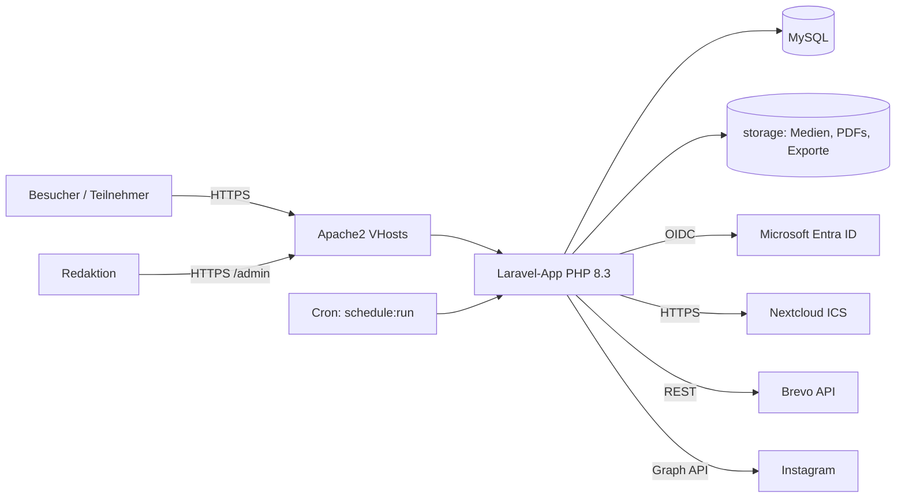
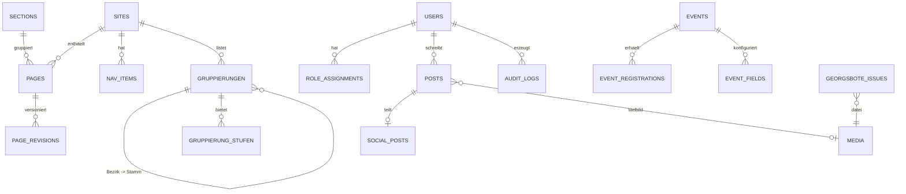

# Pflichtenheft & Systemarchitektur – Custom-CMS DPSG Diözesanverband Trier

| | |
|---|---|
| **Projekt** | Leichtgewichtiges Custom-CMS für dpsg-trier.de |
| **Testumgebung** | test.dpsg-trier.de |
| **Produktion** | www.dpsg-trier.de (+ bolivienpartnerschaft.de als Domain-Alias auf Landingpage) |
| **Version / Stand** | 0.2 (Entwurf) – 30.09.2026 |
| **Status** | Zur Freigabe; Scaffolding erst nach „Go“ |
| **Änderungen zu v0.1** | Gegenprüfung der Farb-/Schrift-/KI-Kennzeichnungsangaben mit dem offiziellen CD-Leitfaden (Stand April 2026); neuer Abschnitt 6.11 „Bezirke- und Stämme-Verzeichnis mit Kartenansicht“ inkl. Datenmodell, API und Technologiewahl |

---

## 1. Ziel, Kontext und Rahmenbedingungen

### 1.1 Ziel
Ein wartungsarmes, sicheres und KDG-konformes CMS, das von Ehrenamtlichen ohne Entwickler-Know-how betrieben werden kann. Der Funktionsumfang ist bewusst begrenzt: Inhalte pflegen, Veranstaltungen verwalten, Newsletter-Archiv und -Anmeldung, Kalender anzeigen, Beiträge auf Instagram teilen.

### 1.2 Gesetzte Rahmenbedingungen
- Verfügbare Plattform: **Apache2, PHP, MySQL**. Kein Node.js-/Docker-Runtime vorausgesetzt.
- Authentifizierung der Redaktion über **Microsoft 365 / Entra ID**, plus lokaler Notfall-Account.
- Layout-Orientierung: bistum-trier.de. Farbwelt: DPSG-Bundesebene (inkl. aller Stufenfarben, insbesondere Biber).
- **KDG-Konformität** ist zwingend (Datenbankdesign, Consent, Double-Opt-In, Event-Management).

### 1.3 Leitprinzipien
1. **Wartungsarmut vor Featurereichtum**: lieber weniger Code, etablierte Bibliotheken, LTS-Versionen.
2. **Kein Build-/Node-Schritt auf dem Server**: Frontend-Assets werden in CI/lokal gebaut und als fertige Dateien deployt.
3. **Datensparsamkeit by Design**: Personenbezogene Daten nur, wenn zwingend nötig, mit automatischer Löschung.
4. **Keine Drittanbieter-Requests im Browser** ohne Einwilligung (Fonts, Skripte, Embeds, auch Kartenkacheln selbst hosten).
5. **Alles Wichtige per Konfiguration** (`.env`/Admin-UI), nichts hardcodiert.

---

## 2. Akteure und Rollen

| Rolle | Beschreibung | Anmeldung |
|---|---|---|
| **Besucher** | Anonyme Website-Nutzer | – |
| **Teilnehmer/in** | Meldet sich zu Veranstaltungen an (ggf. für Minderjährige: Erziehungsberechtigte) | – (Double-Opt-In per E-Mail) |
| **Abonnent/in** | Georgsbote-Newsletter | – (Double-Opt-In über Brevo) |
| **Autor/in** | Ehrenamtliche/r, veröffentlicht eigene News (Freigabe je nach Konfiguration) | Entra ID |
| **Stufenadmin** | Verantwortet eine Stufe (Biber, Wölflinge, Jungpfadfinder, Pfadfinder, Rover): Stufenseite, Stufen-News, Stufen-Veranstaltungen | Entra ID |
| **Sektionsadmin** | Verantwortet eine Sektion (Bolivienpartnerschaft, später Beraten-Online) | Entra ID |
| **Vorstand** | Ehrenamtlicher Diözesanvorstand | Entra ID |
| **Verwaltung** | Diözesanbüro-Mitarbeitende und Bildungsreferent:in: Verwaltung aller Inhalte, Veranstaltungen, Teilnehmerdaten, Georgsbote und Benutzer | Entra ID |
| **Admin (Technik)** | Technische Administration, Integrationen, Systemeinstellungen | Entra ID |
| **Super-Admin (Notfall)** | Break-Glass-Account bei Entra-Ausfall | lokal (DB) + 2FA |

Rechte werden als **Rolle + Geltungsbereich (Scope)** vergeben (Scope = global, Sektion, Stufe oder „eigene Inhalte“). Eine Person kann mehrere Zuweisungen haben, z. B. Stufenadmin Wölflinge und Autorin in der Sektion Bolivien. „Event-Manager“ ist keine eigene Rolle mehr, sondern ein Recht von Stufenadmin, Sektionsadmin und Verwaltung.

---

## 3. Technologie-Vorschlag

### 3.1 Empfehlung

| Schicht | Wahl | Begründung |
|---|---|---|
| Sprache | **PHP 8.3+** | Verfügbar, breit unterstützt |
| Framework | **Laravel 12** | Sicherheitsfunktionen (CSRF, Hashing, Validation, Policies), Migrationen, Scheduler, Queue, großes Ökosystem |
| Admin-Backend | **Filament 4** | Fertiges Admin-Panel (Formulare, Tabellen, Rich-Text, Medien, Rollen) → minimaler Eigencode |
| Frontend | **Blade-Templates + Tailwind CSS + Alpine.js** | Server-Rendering, schnell, barrierearm; Build lokal/CI, ausgeliefert als statische Dateien |
| Datenbank | **MySQL 8 / MariaDB 10.11+** (`utf8mb4`) | Vorhanden |
| Webserver | **Apache2** (`mod_rewrite`, `mod_headers`, `mod_ssl`) | Vorhanden; je Domain ein VirtualHost |
| Queue/Jobs | **Laravel Queue (database driver)** + Cron (`schedule:run` minütlich) | Kein Redis/Supervisor nötig |
| Cache | File/Database-Cache | Kein zusätzlicher Dienst |
| Auth (Entra) | **OIDC/OAuth2 via Laravel Socialite** (Provider `microsoft-azure`) | Standardverfahren, gepflegtes Paket |
| XLSX-Export | **OpenSpout** (alternativ PhpSpreadsheet) | Geringer Speicherbedarf, schreibt echtes .xlsx |
| ICS-Parsing | **sabre/vobject** | Robust, unterstützt wiederkehrende Termine (RRULE) |
| **Karte** | **MapLibre GL JS + PMTiles** (selbstgehosteter Regionalauszug für das Bistum Trier als einzelne statische Datei) | Kein Tile-Server-/Node-Prozess auf dem Server nötig; Apache liefert die Datei per HTTP-Range aus; keine Drittanbieter-Kartenkacheln → consent-frei (s. 6.11, 10.1) |
| Mail | **Brevo SMTP-Relay** (Transaktionsmails: Bestätigungen, Benachrichtigungen) | Standard-SMTP-Mailer von Laravel; Newsletter (Georgsbote) bleiben separat in Brevo, nicht über das CMS |
| Backup | DB-Dump + `storage/` nächtlich (Cron) auf separates Ziel | Siehe NFR |

### 3.2 Begründung der Wartungsarmut
- Composer-Abhängigkeiten werden **minimal** gehalten; `composer audit` + Dependabot/Renovate in CI.
- Laravel bekommt jährlich ein Major-Release; Upgrades sind gut dokumentiert. Alternative bei Wunsch nach längerem LTS: **Symfony 7.4 LTS + EasyAdmin** (mehr Eigenaufwand im Admin-UI).
- Filament ersetzt die größte Menge Eigencode (Backend-UI). Das Frontend bleibt klein und überschaubar.

### 3.3 Verworfene Alternativen
- **WordPress/Typo3/Drupal**: Laufende Plugin-/Patch-Last, große Angriffsfläche – genau das Problem, das gelöst werden soll.
- **Headless CMS (Strapi, Directus)**: Benötigt Node-Runtime und zusätzlichen Betrieb.
- **Statischer Generator**: Keine Self-Service-Formulare/Login ohne Zusatzdienste.
- **Google Maps / Mapbox als eingebettete Karte**: Drittanbieter-Requests bei jedem Seitenaufruf → Consent-Pflicht, laufende API-Key-/Kostenverwaltung. Wird daher **nicht eingebettet**; stattdessen selbstgehostete Kacheln (s. 6.11) und optional ein reiner Hyperlink „In Karten-App öffnen“.

---

## 4. Systemarchitektur

### 4.1 Überblick



### 4.2 Multi-Domain / Multi-Site
- **VirtualHosts**: `www.dpsg-trier.de`, `test.dpsg-trier.de`, `bolivienpartnerschaft.de` (+ www), später `www.beraten-online.de`.
- Die App erkennt den **Host** und wählt die passende **Site** (Tabelle `sites`): Theme, Startseite, Navigation.
- `bolivienpartnerschaft.de` → Landingpage der Sektion „Bolivienpartnerschaft“ (kein Redirect, eigene Domain bleibt sichtbar; Canonical-Tag gesetzt). Zusätzlich erreichbar unter `www.dpsg-trier.de/bolivien`.
- TLS: Let's Encrypt/Hoster-Zertifikate je Domain; HSTS aktiviert.

### 4.3 Verzeichnisstruktur (Soll)
```
/app            Laravel-Code (Models, Policies, Jobs, Services)
/app/Filament   Admin-Ressourcen
/resources      Blade-Views, Tailwind-Quellen
/public         Webroot (nur dieser Ordner ist von Apache erreichbar)
/storage        Uploads, Exporte, Logs (nicht öffentlich außer /storage/public-Link)
/docs           Dokumentation (dieses Pflichtenheft)
```

### 4.4 Deployment
- **GitHub-Repository mit GitHub Actions**; Deployment per **FTP** auf den Webspace. Vorhandene Repository-Secrets: `FTP_SERVER`, `FTP_SERVER_DIR`, `FTP_USERNAME`, `FTP_PASSWORD`.
- **Ablauf der Pipeline**: Checkout → PHP 8.3 + `composer install --no-dev --optimize-autoloader` → Node-Build der Assets (`npm ci && npm run build`, nur in CI) → Tests/Analyse (Pest, Larastan, Pint, `composer audit`) → **inkrementeller FTP-Upload nur geänderter Dateien** (z. B. `SamKirkland/FTP-Deploy-Action`) → Post-Deploy-Schritt.
- **Ausgeschlossen vom Upload**: `.env`, `.git*`, `node_modules`, `tests`, `storage/` (Laufzeitdaten, Logs, Uploads). Die **`.env` wird einmalig manuell auf dem Server angelegt** und nie im Repository oder in Workflow-Logs geführt (APP_KEY, DB-Zugang, Brevo-SMTP-Key, Entra-Client-Secret, Instagram-Token).
- **GitHub Environments**: `test` und `production` mit jeweils eigenen Secrets (insbesondere eigenem `FTP_SERVER_DIR`). Produktions-Deployments nur aus `main`/Release-Tag und mit manueller Freigabe. Push auf `develop` bzw. Feature-Branch → `test`.
- **Transportsicherheit**: FTP nur mit **FTPS (explizites TLS) oder SFTP**, kein unverschlüsseltes FTP; beim Anbieter prüfen, was angeboten wird.
- **Post-Deploy (Migrationen, Caches)**: FTP kann keine Befehle ausführen. Bevorzugt: Schritt per **SSH** aus der Pipeline (SSH-Key aus dem Panel als Secret `SSH_PRIVATE_KEY`) mit `php artisan migrate --force && php artisan config:cache route:cache view:cache && php artisan queue:restart`. Fallback ohne SSH: Cron-Job minütlich, der bei vorhandener Marker-Datei (`storage/app/deploy.flag`, per FTP hochgeladen) das Post-Deploy-Skript ausführt und die Datei löscht. **Kein per Web erreichbarer Deploy-Endpunkt.**
- **Rollback**: erneutes Ausführen der Pipeline für den vorherigen Tag; Datenbankmigrationen werden rückwärtskompatibel geschrieben (erst ergänzen, später entfernen).
- **Übergangslösung Webroot (Test)**: Solange der DocumentRoot noch auf `httpdocs` zeigt, wird die App in `httpdocs` ausgeliefert und eine `.htaccess` leitet alle Anfragen auf `public/` um und sperrt `.env`, `vendor`, `storage`, `app`, `config` u. a. **Für den Livebetrieb ist die Umstellung des DocumentRoots auf `public/` verpflichtend** (Abnahmekriterium).
- Zero-Downtime ist nicht gefordert; Wartungsmodus via `php artisan down`.
- Umgebungen: **test** (test.dpsg-trier.de) und **prod**, getrennte Datenbanken und `.env`.

### 4.5 Hosting-Umgebung (Ist-Stand)
Webhosting bei netcup (Webhosting-Control-Panel, WCP). Test und Live liegen auf **demselben Server**.

| Merkmal | Ist-Stand | Bewertung |
|---|---|---|
| PHP | **8.3.x** (im Panel einstellbar) | ✔ passt zu Laravel 12 |
| Composer | im Panel verfügbar | ✔ |
| Git | im Panel verfügbar | ✔ (Deployment läuft über GitHub Actions + FTP, siehe 4.4) |
| SSH | SSH-Keys im Panel verwaltbar | ✔ (Shell-Zugriff beim Anbieter bestätigen) |
| Geplante Aufgaben | vorhanden | ✔ für Scheduler/Queue (Mindestintervall prüfen) |
| Datenbanken | MySQL/MariaDB über Panel | ✔ |
| Speicher | 500 GB | ✔ ausreichend für PDFs/Medien |
| Node.js | nicht ersichtlich | ✔ unkritisch, Assets werden extern gebaut |
| Webroot | Standard `…/httpdocs` | ⚠ siehe Anforderungen unten |
| SSL/TLS | Hinweis „Sicherheit kann verbessert werden“ | ⚠ Zertifikat/HTTPS-Erzwingung einrichten |

**Daraus abgeleitete Anforderungen**
1. **Webroot auf `public/` umstellen** (zweite Priorität, vor Go-Live zwingend; Übergang siehe 4.4): Der DocumentRoot der Website muss auf das Laravel-Verzeichnis `public/` zeigen (Einstellung unter „Hosting und DNS“). Falls nicht änderbar: App oberhalb von `httpdocs` ablegen und nur `public/`-Inhalt dort bereitstellen (angepasste `index.php`). `.env`, `storage/`, `vendor/` dürfen nie im Webroot liegen.
2. **Trennung Test/Live**: eigene Datenbank, eigene `.env`, eigene App-Schlüssel, eigene Entra-App-Registrierung je Umgebung. Da derselbe Server genutzt wird, **keine Live-Daten in Test kopieren**; Test per Passwortschutz (Basic Auth) oder IP-Beschränkung absichern und mit `noindex` versehen.
3. **Mehrere Domains**: `bolivienpartnerschaft.de` (und später `beraten-online.de`) müssen als zusätzliche Domain/Alias auf dieselbe Website zeigen, damit die App das Host-Routing übernimmt. Je Domain eigenes TLS-Zertifikat.
4. **Cron**: Ein Eintrag `php artisan schedule:run` jede Minute (ansonsten Mindestintervall des Anbieters prüfen und Scheduler-Takte anpassen).
5. **PHP-Erweiterungen/Limits prüfen** (vor Scaffolding per `php -m`): `intl`, `mbstring`, `gd` oder `imagick`, `zip`, `xml`, `curl`, `openssl`, `pdo_mysql`; außerdem `memory_limit`, `max_execution_time`, `upload_max_filesize` (für PDF-Uploads) und ob Funktionen wie `proc_open` freigeschaltet sind.
6. **Backups**: Das Panel-Backup genügt nicht allein. Zusätzlich nächtlicher DB-Dump + `storage/` an ein **separates Ziel außerhalb des Servers**.
7. **Kein Shell-Root, keine Daemons**: Queue-Worker laufen über Cron (`queue:work --stop-when-empty`), nicht als dauerhafter Prozess.
8. **Ausgehender SMTP**: Verbindung zu Brevo (Port 587, STARTTLS) muss vom Hosting aus möglich sein; beim Anbieter bzw. per Testmail prüfen.

---

## 5. Authentifizierung und Autorisierung

### 5.1 Entra-ID-Login (Redaktion)
- Verfahren: OpenID Connect, Authorization-Code-Flow mit PKCE, **Single-Tenant** (nur Verbands-Tenant).
- Entra übernimmt **nur die Authentifizierung**. Die fachlichen Rollen samt Scope (Stufe/Sektion) werden **im CMS** verwaltet, da Entra App Roles keine Stufen-/Sektionsbindung abbilden. Die Enterprise-App wird auf „Zuweisung erforderlich“ gestellt, damit sich nur ausdrücklich freigegebene Personen anmelden können.
- Jede Rollenzuweisung ist an **ein konkretes M365-Konto** gebunden (Schlüssel: unveränderliche Entra-Objekt-ID `oid`, nicht E-Mail/UPN). Rollen können **vor der ersten Anmeldung** vergeben werden (siehe 5.6). Meldet sich ein Konto ohne Zuweisung an, wird es als „wartet auf Freischaltung“ angelegt, hat **keinen Zugriff**, und die Verwaltung wird benachrichtigt.
- Deaktivierte Entra-Konten verlieren Zugang spätestens beim nächsten Token-/Session-Ablauf (Session-Lebensdauer max. 8 h).
- Redirect-URIs: test- und prod-Domain separat registriert.

### 5.2 Notfall-Super-Admin (Break-Glass)
- **DB-basiert, nicht hardcodiert** (Hardcoding wäre ein Sicherheitsrisiko im Repository). Anlage einmalig per Artisan-Kommando `php artisan cms:create-superadmin`.
- Passwort mit **Argon2id**, Mindestlänge 16 Zeichen, **TOTP-2FA verpflichtend**.
- Separater Login-Pfad (nicht verlinkt, z. B. `/notfall-login`), Rate-Limiting (5 Versuche / 15 Min.).
- Jede Anmeldung löst eine **E-Mail-Benachrichtigung** an die Admin-Adressen aus und wird im Audit-Log vermerkt.
- Optional: IP-Beschränkung per Apache-`Require ip`.
- Organisatorisch: Zugangsdaten in einem Passwortmanager mit Vier-Augen-Zugriff; Test des Zugangs halbjährlich.

### 5.3 Rollenmodell mit Scopes

| Rolle | Scope | Kurzbeschreibung |
|---|---|---|
| `autor` | eigene Inhalte (optional einer Stufe/Sektion zugeordnet) | Legt eigene News an und bearbeitet nur diese |
| `stufenadmin` | je Stufe (Biber, Wölflinge, Jungpfadfinder, Pfadfinder, Rover) | Stufenseite, News, Veranstaltungen und Teilnehmer der eigenen Stufe |
| `sektionsadmin` | je Sektion (Bolivien, später Beraten-Online) | Wie Stufenadmin, bezogen auf die Sektion |
| `vorstand` | Vorstandsbereich | Vorstandsseiten, Freigabe von News, Einsicht in Veranstaltungsübersichten (Anzahlen, keine Teilnehmerdaten) |
| `verwaltung` | global | Alles Redaktionelle und Administrative (Büro/Bildungsreferent:in) |
| `admin` | global | Technik: Systemeinstellungen, Integrationen, Tokens |
| `superadmin` | global | Notfallzugang |

### 5.4 Berechtigungsmatrix

Legende: ● = voll, ◐ = nur im eigenen Scope, – = nein

| Funktion | Autor | Stufenadmin | Sektionsadmin | Vorstand | Verwaltung | Admin | Super-Admin |
|---|:-:|:-:|:-:|:-:|:-:|:-:|:-:|
| Eigene News anlegen/bearbeiten | ◐ | ◐ | ◐ | ● | ● | ● | ● |
| Eigene News direkt veröffentlichen | konfigurierbar | ◐ | ◐ | ● | ● | ● | ● |
| News anderer freigeben/bearbeiten | – | ◐ | ◐ | ● (Freigabe) | ● | ● | ● |
| Seiten der Stufe/Sektion pflegen | – | ◐ | ◐ | – | ● | ● | ● |
| Vorstandsseiten pflegen | – | – | – | ● | ● | ● | ● |
| Globale Seiten/Navigation/Rechtstexte | – | – | – | – | ● | ● | ● |
| Medien hochladen | ◐ | ◐ | ◐ | ● | ● | ● | ● |
| Veranstaltungen anlegen | – | ◐ | ◐ | – | ● | ● | ● |
| Teilnehmerlisten ansehen/exportieren | – | ◐ (eigene Events) | ◐ (eigene Events) | nur Anzahlen | ● | ● | ● |
| Georgsbote-Archiv pflegen | – | – | – | – | ● | ● | ● |
| Blog → Instagram veröffentlichen | – | ◐ (Freigabe) | ◐ (Freigabe) | ● | ● | ● | ● |
| Autoren im eigenen Scope freischalten | – | ◐ | ◐ | – | ● | ● | ● |
| Benutzer/Rollen global verwalten | – | – | – | – | ● (ohne Admin/Super-Admin) | ● | ● |
| Datenschutzfunktionen (Auskunft/Löschung) | – | – | – | – | ● | ● | ● |
| Audit-Log einsehen | – | – | – | – | lesend | ● | ● |
| Systemeinstellungen, Integrationen, Tokens | – | – | – | – | – | ● | ● |

Umsetzung über Laravel Policies mit Scope-Prüfung (Tabelle `role_assignments`) und Filament-Zugriffssteuerung. Jede Abfrage wird auf den Scope des Benutzers gefiltert (Query-Scopes), nicht nur die Anzeige.

### 5.5 Delegation und Freigabe-Workflow
- Stufen- und Sektionsadmins dürfen Autoren **innerhalb ihres Scopes freischalten** (Rolle `autor`), sodass die Verwaltung nicht jeden Einzelfall anlegen muss.
- Beitrags-Status: `Entwurf → Zur Prüfung → Veröffentlicht`. Ob Autoren direkt veröffentlichen dürfen, ist pro Scope einstellbar (Standard: Freigabe erforderlich).
- Zugriff auf Teilnehmerdaten folgt dem **Need-to-know-Prinzip**: nur Verwaltung und die Berechtigten des Scopes der Veranstaltung.
- Jede Rollenvergabe und -änderung wird im Audit-Log protokolliert; ausgeschiedene Personen werden über Deaktivierung in Entra und zusätzlich über einen Jahres-Review der Rollenzuweisungen entfernt.

### 5.6 Benutzerverwaltung und Zuordnung zu M365-Konten
| ID | Anforderung | Prio |
|---|---|:-:|
| F-USR-01 | Backend-Bereich „Benutzer“: Rollen mit Scope (siehe 5.3) einzelnen M365-Konten zuordnen, ändern und entziehen; mehrere Zuweisungen je Person möglich | M |
| F-USR-02 | **Benutzersuche im Entra-Verzeichnis** (Name/E-Mail) über Microsoft Graph, um Personen auszuwählen und **vorab** freizuschalten; bei der ersten Anmeldung wird der Datensatz über die `oid` bzw. UPN verknüpft | M |
| F-USR-03 | Alternative ohne Verzeichnissuche: Eingabe der M365-E-Mail-Adresse; Verknüpfung bei der ersten Anmeldung | M |
| F-USR-04 | Gastkonten (B2B) werden unterstützt, falls Autor:innen ohne Verbands-Konto zugelassen werden sollen | S |
| F-USR-05 | Delegation: Stufen-/Sektionsadmins sehen und vergeben nur Zuweisungen **innerhalb ihres Scopes** (siehe 5.5); Verwaltung global (ohne Admin/Super-Admin) | M |
| F-USR-06 | Benutzerliste mit Filter (Rolle, Scope, Status: aktiv / wartet auf Freischaltung / deaktiviert), letzte Anmeldung | M |
| F-USR-07 | Deaktivierung im CMS sofort wirksam; Deaktivierung/Sperrung in Entra verhindert die Anmeldung unmittelbar, bestehende CMS-Sitzungen laufen spätestens nach 8 h ab | M |
| F-USR-08 | Optional (Phase 2): nächtlicher Abgleich mit Entra (Konto deaktiviert/gelöscht → CMS-Zuweisungen automatisch deaktivieren) | K |
| F-USR-09 | Jahres-Review: Bericht aller aktiven Zuweisungen zur Bestätigung durch die Verwaltung | S |
| F-USR-10 | **Optional (Kann):** lokaler CMS-Login mit Pflicht-TOTP für Personen ohne M365-Konto; standardmäßig deaktiviert, nur durch Admin aktivierbar. Regelfall bleibt die Anmeldung über Entra | K |

**Entra-App-Registrierung (Berechtigungen, minimal gehalten)**
- Anmeldung: `openid`, `profile`, `email` (delegiert).
- Benutzersuche: Microsoft Graph **`User.ReadBasic.All` (delegiert)**: liest nur Basisdaten (Name, E-Mail, ID) im Namen der angemeldeten Verwaltungsperson; kein dauerhafter Vollzugriff auf das Verzeichnis. Notwendigkeit eines Admin-Consents mit dem Tenant-Admin klären.
- Nur für den optionalen Nachtabgleich (F-USR-08): `User.Read.All` (Anwendung, Admin-Consent), bewusst erst in Phase 2.
- Enterprise-App: „Zuweisung erforderlich“ aktiv; Benutzer/Gruppen, die sich anmelden dürfen, im Tenant freigeben.
- Es werden **keine** weiteren Verzeichnisdaten (Telefon, Abteilung, Fotos) gespeichert (Datensparsamkeit).

---

## 6. Funktionale Anforderungen

Priorität: **M** = Muss, **S** = Soll, **K** = Kann. Phase 1 = MVP, Phase 2 = später.

### 6.1 Redaktionelle Inhalte (Basis) – Phase 1
| ID | Anforderung | Prio |
|---|---|:-:|
| F-CMS-01 | Seiten mit hierarchischer Navigation (Haupt-/Untermenü) | M |
| F-CMS-02 | Rich-Text-Editor (Überschriften, Listen, Links, Bilder, Zitate), bereinigtes HTML (Whitelist) | M |
| F-CMS-03 | Blog/News mit Titel, Teaser, Bild, Kategorie, Veröffentlichungsdatum, Entwurf/Veröffentlicht | M |
| F-CMS-04 | Mediathek mit Upload (Bilder, PDF), automatische Bildskalierung (WebP), Pflichtfeld Alt-Text | M |
| F-CMS-05 | Stufen-Seiten (Biber, Wölflinge, Jungpfadfinder, Pfadfinder, Rover) mit Stufenfarbe | M |
| F-CMS-06 | Seitenversionierung (letzte 10 Versionen, Wiederherstellung) | S |
| F-CMS-07 | Volltextsuche (MySQL FULLTEXT) | S |
| F-CMS-08 | Impressum, Datenschutzerklärung, Kontakt als pflegbare Pflichtseiten | M |
| F-CMS-09 | Kontaktformular (ohne Speicherung, nur Mailversand, Spamschutz per Honeypot + Rate-Limit) | S |
| F-CMS-10 | Autoren-Workflow: Entwurf → Zur Prüfung → Veröffentlicht; Autoren bearbeiten nur eigene Beiträge; Freigabe je Scope konfigurierbar | M |
| F-CMS-11 | News werden einem Scope zugeordnet (allgemein, Stufe, Sektion, Vorstand) und erscheinen gefiltert auf Startseite, Stufen-/Sektionsseite und im Feed | M |
| F-CMS-12 | Vorstandsseite(n) (Vorstellung, Kontakt); ob zusätzlich ein geschützter interner Bereich gewünscht ist, ist zu klären | S |
| F-CMS-13 | Benachrichtigung der Freigebenden per E-Mail, wenn ein Beitrag „Zur Prüfung“ eingereicht wird | S |
| F-CMS-14 | Pflichtfeld **Bildnachweis** (Urheber:in) je Bild und Bestätigung „Einwilligung liegt vor“ bei Personenfotos; Editor-Feld **KI-Kennzeichnung** je Beitrag mit drei Stufen gemäß CD-Leitfaden Abschnitt 13: (1) vollständig KI-generiert → automatischer Hinweistext „Text/Bild/Video wurde mithilfe des KI-Tools [Name] generiert.“, (2) teilweise KI-unterstützt → „[Name der erstellenden Person] in Zusammenarbeit mit dem KI-Tool [Name].“, (3) nur unterstützend genutzt (Rechtschreibung, Recherche, Formulierungshilfe) → keine Kennzeichnung nötig. Die Auswahl steuert automatisch den im Frontend angezeigten Hinweistext | M |

### 6.2 Bolivienpartnerschaft – Phase 1
| ID | Anforderung | Prio |
|---|---|:-:|
| F-BOL-01 | Eigene, prominente Sektion mit Landingpage (Hero, Projekte, Aktuelles, Spenden/Kontakt) | M |
| F-BOL-02 | Host-basiertes Routing: `bolivienpartnerschaft.de` zeigt die Landingpage | M |
| F-BOL-03 | Eigene Navigation und eigener Farb-Akzent innerhalb des DPSG-Designs | S |
| F-BOL-04 | Blog-Kategorie „Bolivien“ mit eigener Übersicht und Feed | S |
| F-BOL-05 | Sektions-Redakteure mit Rechten nur für diese Sektion | M |
| F-BOL-06 | Spendenhinweis mit Bankverbindung als Text (keine Zahlungsabwicklung im CMS) | S |

### 6.3 Beraten-Online – Phase 2 (konzeptionell vorbereitet)
| ID | Anforderung | Prio |
|---|---|:-:|
| F-BER-01 | Architektur erlaubt eine weitere Site (`sites`-Eintrag, eigenes Theme) ohne Code-Umbau | M (Vorbereitung) |
| F-BER-02 | Layout-Konzept (Wireframes) für www.beraten-online.de: Startseite, Angebot, Ausbildung, Anmeldung | K |
| F-BER-03 | Später: Ausbildungs-/Schulungstermine (Wiederverwendung des Veranstaltungsmoduls) | K |
| F-BER-04 | Später: Verteilung/Zuordnung ehrenamtlicher Berater:innen – **Anforderungen noch zu klären** (Gesundheits-/Beratungsbezug → besonders sensibel, eigene Datenschutz-Folgenabschätzung erforderlich) | K |

### 6.4 Instagram-Integration – Phase 1 (S) / Phase 2
| ID | Anforderung | Prio |
|---|---|:-:|
| F-IG-01 | Im Blog-Editor: Option „Auf Instagram teilen“ mit Bild, Caption (max. 2.200 Zeichen), Link-Hinweis | S |
| F-IG-02 | Veröffentlichung per **Instagram Graph API** (Media-Container erstellen → publizieren), asynchron als Queue-Job | S |
| F-IG-03 | Voraussetzung: Instagram **Business-/Creator-Konto**, verknüpft mit Facebook-Seite und Meta-App | – |
| F-IG-04 | Token-Verwaltung: Long-Lived-Token (ca. 60 Tage) wird automatisch **per Scheduler erneuert**; bei Fehler E-Mail an Admin | S |
| F-IG-05 | Status je Beitrag (ausstehend / veröffentlicht / Fehler) + Instagram-Permalink im Backend | S |
| F-IG-06 | Freigabe-Schritt: Nur Redakteure mit Berechtigung dürfen posten (Vier-Augen optional) | S |
| F-IG-07 | Anzeige von Instagram-Inhalten im Frontend **nicht** per Embed (Tracking); falls gewünscht, nur lokal gespiegelte Beitragsbilder | K |

**Hinweise**: Bilder müssen öffentlich per URL erreichbar und JPEG sein; Karussells möglich. Meta-App-Review für `instagram_content_publish` kann nötig sein (Aufwand und Zeit einplanen). API-Bedingungen können sich ändern → Integration kapseln (Service-Klasse), Fehlertoleranz einbauen.

### 6.5 Nextcloud-Kalender – Phase 1
| ID | Anforderung | Prio |
|---|---|:-:|
| F-CAL-01 | Konfigurierbare ICS-URL(s) (öffentlicher Freigabelink, Admin-UI, mehrere Kalender mit Farbe/Label) | M |
| F-CAL-02 | Abruf per Scheduler alle 15 Minuten, Ergebnis gecacht; bei Nextcloud-Ausfall wird der letzte gültige Stand angezeigt | M |
| F-CAL-03 | Parsing inkl. Wiederholungen (RRULE), Ausnahmen (EXDATE), Zeitzonen (Europe/Berlin), ganztägige Termine | M |
| F-CAL-04 | Frontend: Monats- und Listenansicht, Filter nach Kalender/Stufe, Termin-Detail (Titel, Ort, Beschreibung) | M |
| F-CAL-05 | Datenschutz: Nur Felder anzeigen, die freigegeben sind; Teilnehmer-/Organizer-E-Mail-Adressen aus dem ICS **werden nicht ausgegeben** | M |
| F-CAL-06 | Optional: ICS-Export/Abo des gefilterten Kalenders | K |
| F-CAL-07 | SSRF-Schutz: URL-Whitelist (nur konfigurierte Nextcloud-Domain), Timeout 10 s, max. Größe 5 MB | M |

### 6.6 Georgsbote (Brevo) – Phase 1
**Archiv**
| ID | Anforderung | Prio |
|---|---|:-:|
| F-GB-01 | Archivseite: PDF-Ausgaben nach Jahrgang/Ausgabe, Titelbild (automatisch aus Seite 1 erzeugt oder hochgeladen) | M |
| F-GB-02 | Backend: Upload von PDF, Metadaten (Jahr, Ausgabe, Titel), Veröffentlichungsdatum | M |
| F-GB-03 | **Veröffentlichungsprüfung**: Checkliste/Hinweis, dass Personenbezug (Fotos, Namen, Adressen) geklärt ist, bevor eine Ausgabe online geht; Möglichkeit, einzelne Ausgaben nicht zu veröffentlichen | M |
| F-GB-04 | Altjahrgänge: Import per Bulk-Upload | S |
| F-GB-05 | PDFs mit sprechendem, nicht erratbarem Pfad; Download-Zähler optional **ohne** Personenbezug | K |

**Newsletter-Anmeldung**
| ID | Anforderung | Prio |
|---|---|:-:|
| F-GB-10 | Formular: E-Mail (Pflicht), Vorname (optional), Einwilligungstext + Link zur Datenschutzerklärung | M |
| F-GB-11 | Anbindung per **Brevo API** `POST /v3/contacts/doubleOptinConfirmation` mit Template-ID und Redirect-URL; Kontakt landet erst **nach Bestätigung** in der Liste | M |
| F-GB-12 | Keine lokale Speicherung der E-Mail-Adresse im CMS (Durchreichen an Brevo; nur Audit-Eintrag ohne Klartext-Adresse, z. B. Hash + Zeitstempel) | M |
| F-GB-13 | Abmeldung über Brevo-Abmeldelink in jedem Newsletter; zusätzlich Hinweis/Seite „Abmelden“ | M |
| F-GB-14 | Brevo-Webhook (optional): Events `unsubscribed`, `hardBounce` → nur Statistik, keine Personendaten im CMS | K |
| F-GB-15 | Spamschutz: Honeypot, Rate-Limit je IP, optional Altcha/Friendly Captcha (selbst gehostet, kein Google reCAPTCHA) | M |
| F-GB-16 | Brevo-API-Key nur in `.env`, nie im Frontend | M |

**Voraussetzungen KDG**: Auftragsverarbeitungsvertrag mit Brevo (AVV nach KDG), Serverstandort EU, Löschkonzept; siehe Abschnitt 9.

### 6.7 Veranstaltungsmanagement (Eigenentwicklung) – Phase 1
**Backend (Event-Manager/Admin)**
| ID | Anforderung | Prio |
|---|---|:-:|
| F-EV-01 | Veranstaltung anlegen/bearbeiten: Titel, Beschreibung, Zeitraum, Ort, Stufe/Zielgruppe, Bild, Kontaktperson | M |
| F-EV-02 | Anmeldezeitraum (Start/Ende), Teilnehmerlimit, Warteliste (optional), Status (Entwurf/Offen/Geschlossen/Abgesagt) | M |
| F-EV-03 | **Konfigurierbarer Formularumfang je Veranstaltung** aus einem Baukasten (Datensparsamkeit): Pflichtfelder Name, E-Mail; optional Geburtsdatum/Alter, Stamm, Telefon, Verpflegung, Kommentar | M |
| F-EV-04 | Kostenbeitrag als Infotext (keine Zahlungsabwicklung im Phase 1) | S |
| F-EV-05 | Teilnehmerübersicht mit Status (angemeldet, bestätigt, Warteliste, storniert) | M |
| F-EV-06 | Manuelles Stornieren/Verschieben in Warteliste | S |
| F-EV-07 | Duplizieren früherer Veranstaltungen | K |
| F-EV-08 | Jede Veranstaltung ist einer Stufe/Sektion zugeordnet; Zugriff auf Teilnehmerdaten nur für Berechtigte dieses Scopes und die Verwaltung | M |

**Frontend (Teilnehmer)**
| ID | Anforderung | Prio |
|---|---|:-:|
| F-EV-10 | Veranstaltungsübersicht und Detailseite mit Anmeldung | M |
| F-EV-11 | Anmeldeformular gemäß Konfiguration, Einwilligungs-/Datenschutzhinweis (Pflicht-Checkbox), Hinweis zur Aufbewahrungsdauer | M |
| F-EV-12 | **E-Mail-Bestätigung (Double-Opt-In)**: Anmeldung gilt erst nach Klick auf Bestätigungslink (Gültigkeit 48 h) | M |
| F-EV-13 | Bestätigungsmail mit Stornierungs-/Änderungslink (signierter Token) | M |
| F-EV-14 | **Minderjährige**: Feld „Anmeldung durch Erziehungsberechtigte“; bei unter 16 Jahren Einwilligung durch Personensorgeberechtigte (KDG) | M |
| F-EV-15 | Warteschlange/Nachrücken per Mail | S |
| F-EV-16 | Barrierefreies, mobiloptimiertes Formular | M |

**Export**
| ID | Anforderung | Prio |
|---|---|:-:|
| F-EV-20 | Download der Teilnehmerliste als **.xlsx** (und optional .xls-kompatibel/CSV) mit vordefinierten Spalten je Veranstaltung | M |
| F-EV-21 | Export nur für berechtigte Rollen, jeder Export wird im Audit-Log protokolliert (wer, wann, welche Veranstaltung) | M |
| F-EV-22 | Dateien werden **nicht dauerhaft gespeichert**, sondern on-the-fly erzeugt und direkt ausgeliefert | M |
| F-EV-23 | Excel-Formelinjektion verhindern (Zellen mit `= + - @` am Anfang maskieren) | M |
| F-EV-24 | Optional: Druckansicht/Unterschriftenliste (PDF) | K |

**Automatische Löschung**: Siehe Abschnitt 9.3 (z. B. 90 Tage nach Veranstaltungsende, anpassbar).

### 6.8 Consent-Management – Phase 1
| ID | Anforderung | Prio |
|---|---|:-:|
| F-CON-01 | Cookie-/Consent-Banner (selbst gehostet, ohne externe Dienste), Kategorien: *Notwendig* (immer), optional *Statistik*, *Externe Inhalte* | M |
| F-CON-02 | **Ohne Einwilligung werden keine nicht-notwendigen Skripte geladen oder Requests an Dritte gesendet** | M |
| F-CON-03 | Widerruf jederzeit über Footer-Link „Datenschutz-Einstellungen“ | M |
| F-CON-04 | Einwilligung wird im Browser (Cookie/LocalStorage, 6 Monate) gespeichert, **nicht** serverseitig personenbezogen | M |
| F-CON-05 | Statistik optional mit **selbst gehostetem Matomo** (IP-Anonymisierung) oder ganz ohne Tracking | K |
| F-CON-06 | Schriftarten, Icons, Skripte, **Kartenkacheln** **lokal** ausliefern (keine Google Fonts/CDNs, keine externen Map-Tile-Server) | M |
| F-CON-07 | Externe Einbettungen (Karten, Videos) nur per Zwei-Klick-Lösung mit Platzhalter | S |

### 6.9 WordPress-Migration – Phase 1e
| ID | Anforderung | Prio |
|---|---|:-:|
| F-MIG-01 | Import-Kommando `php artisan wp:import` mit Quelle WordPress-REST-API (`/wp-json/wp/v2/…`) oder WXR-Exportdatei; **wiederholbar (idempotent über `wp_id`)** und mit Dry-Run | M |
| F-MIG-02 | Mapping: Titel, Slug (bleibt erhalten), Datum, Auszug → Teaser, Titelbild, Kategorien/Tags → Scope (Stufe/Sektion) über eine Mapping-Tabelle, Autor → CMS-Autor (Fallback „Redaktion“) | M |
| F-MIG-03 | Inhaltskonvertierung: Gutenberg-Blockkommentare, Shortcodes und Page-Builder-Markup bereinigen → sauberes, sanitisiertes HTML; interne Links umschreiben; Embeds (z. B. Videos) als Zwei-Klick-Platzhalter | M |
| F-MIG-04 | Medien herunterladen, in die Mediathek übernehmen, WebP-Varianten erzeugen; fehlende Alt-Texte auf einer Nacharbeitsliste ausweisen | M |
| F-MIG-05 | **301-Weiterleitungen** von alten WordPress-URLs auf die neuen (Tabelle `redirects`) | M |
| F-MIG-06 | Importierte Beiträge erhalten zunächst Status „Entwurf (importiert)“; Veröffentlichung erst nach Durchsicht (Personenbezug, Bildrechte) | M |
| F-MIG-07 | WordPress-Kommentare und -Benutzerdaten werden **nicht** übernommen (Datensparsamkeit) | M |
| F-MIG-08 | Migrationsbericht (importiert/übersprungen/Fehler) im Backend abrufbar | S |
| F-MIG-09 | Import statischer WordPress-Seiten nach Bedarf (Seiten-Mapping) | K |
| F-MIG-10 | **Umfang**: nur Beiträge der letzten 3 Jahre (ca. 50; Filter `--since`). Bei dieser Menge ist ein halbautomatisches Vorgehen vorgesehen: Import, anschließend manuelle Durchsicht jedes Beitrags vor Veröffentlichung. Ältere Beiträge werden nicht migriert | M |

### 6.10 E-Mail-Versand über Brevo SMTP – Phase 1
| ID | Anforderung | Prio |
|---|---|:-:|
| F-MAIL-01 | Alle Transaktionsmails (Anmelde-Bestätigung, Stornierung, Warteliste, Kontaktformular, Freigabe-Hinweise, Alarmmail Notfall-Login, Fehlerbenachrichtigungen) laufen über das **Brevo SMTP-Relay** (Port 587, STARTTLS); Zugangsdaten nur in `.env` | M |
| F-MAIL-02 | **Absenderdomain authentifizieren** (SPF, DKIM, DMARC für dpsg-trier.de) über die Brevo-Domainfreigabe; dafür Zugriff auf die DNS-Einstellungen nötig | M |
| F-MAIL-03 | Öffnungs-/Klick-Tracking für Transaktionsmails **deaktiviert** (Einstellung im Brevo-Konto prüfen) | M |
| F-MAIL-04 | Datensparsame Inhalte: keine Zusatz-/Gesundheitsdaten in Mails, nur Veranstaltungstitel, Name, Status und Links | M |
| F-MAIL-05 | Versand asynchron über die Queue, Wiederholungen mit Backoff, Fehler im Backend sichtbar; Tageslimit des Brevo-Tarifs beachten | M |
| F-MAIL-06 | **Testumgebung**: Alle ausgehenden Mails werden auf eine konfigurierbare Testadresse umgeleitet (verhindert, dass beim Testen echte Personen angeschrieben werden) | M |
| F-MAIL-07 | Separate Absenderadressen für Transaktionsmails (z. B. `events@`) und Newsletter (Georgsbote), damit Reputation und Zweckbindung getrennt bleiben | S |

### 6.11 Bezirke- und Stämme-Verzeichnis mit Kartenansicht – Phase 1
Übersicht aller Bezirke und Stämme des Diözesanverbands mit Adresse, Kontaktdaten und Standort auf einer Karte – als zentrale „Wo finde ich meinen Stamm?“-Seite. Die Vorgänger-Website hatte dafür ein WP-Google-Maps-Plugin im Einsatz, dessen Datenbestand bei der Migrationsanalyse nur **einen einzigen gepflegten Eintrag** enthielt; die Funktion ist also inhaltlich neu aufzubauen (siehe F-MAP-10 und Abschnitt 14).

| ID | Anforderung | Prio |
|---|---|:-:|
| F-MAP-01 | Verzeichnis aller Bezirke und Stämme mit Name, Adresse, Kontakt (Funktionsadresse, optional Telefon), Website-/Social-Link, angebotenen Stufen und optionalem Logo | M |
| F-MAP-02 | Kartenansicht mit einem Pin je Bezirk/Stamm; Klick auf Pin öffnet eine Detailkarte (Name, Adresse, Kontakt, Stufen als farbige Badges in den jeweiligen Stufenfarben, s. 7.2) | M |
| F-MAP-03 | Parallele, barrierefreie **Listenansicht** (auch ohne JavaScript nutzbar), filterbar nach Bezirk und Stufe, synchron mit der Karte; auf Mobilgeräten Umschaltung „Karte / Liste“ statt Nebeneinander | M |
| F-MAP-04 | Karte **selbstgehostet ohne externe Kartenkachel-Anfragen** (MapLibre GL JS + PMTiles-Regionalauszug für das Bistum Trier, s. 3.1/3.3) → **keine Consent-Einwilligung nötig** (erfüllt F-CON-02/06) | M |
| F-MAP-05 | Standort wird im Backend **manuell per Klick auf die Karte** gesetzt, kein automatisches Geocoding über einen Drittdienst bei jeder Adresseingabe; die Adresse selbst dient nur der Textanzeige | M |
| F-MAP-06 | Backend: Bezirke/Stämme anlegen, bearbeiten, sortieren, Aktiv/Inaktiv schalten (z. B. ruhende Stämme ausblenden statt löschen) | M |
| F-MAP-07 | Ein Stamm kann optional einem Bezirk zugeordnet werden (einfache Hierarchie); die Bezirksseite zeigt die zugehörigen Stämme automatisch in Karte und Liste | M |
| F-MAP-08 | Kontaktangaben nutzen grundsätzlich **Funktionsadressen** (z. B. `stamm-xy@dpsg-trier.de`) statt privater Kontaktdaten Einzelner (Datensparsamkeit, s. 9.1); ein Name als Ansprechperson ist optional und nur mit deren Einwilligung | M |
| F-MAP-09 | Pflege der Einträge zunächst zentral durch die Verwaltung; ein eigener Scope `bezirk`/`stamm` analog zum Stufenadmin (s. 5.3) zur Delegation an die Bezirke selbst ist als spätere Erweiterung vorgesehen | K |
| F-MAP-10 | **Datengrundlage vor Go-Live**: vollständige Erhebung/Abfrage bei allen Bezirken und Stämmen, da die Altdaten unvollständig sind (s. o.); fehlende Einträge zeigen einen Hinweis „noch nicht erfasst“ statt einer Lücke in der Karte | M |
| F-MAP-11 | Öffentliche, gecachte **GeoJSON-Schnittstelle** (`/api/gruppierungen.geojson`) als Datenquelle für die Karte | S |

---

## 7. Design und UI

### 7.1 Layout (Anlehnung an bistum-trier.de)
- Schlanker Header mit Logo, Hauptnavigation (Mega-/Dropdown-Menü), Suche, Kontakt-/Service-Links.
- Große Hero-/Teaser-Fläche auf der Startseite, darunter Kachel-Raster (Aktuelles, Veranstaltungen, Stufen, Bolivien, Georgsbote, Bezirke & Stämme).
- Breadcrumbs, klare Seitenspalte bei Unterseiten, umfangreicher Footer (Kontakt, Rechtliches, Social).
- Mobile-first, responsive Breakpoints (≥ 360 px).
- Es wird **kein Code oder Markenmaterial des Bistums kopiert**, nur Strukturprinzip (Raster, Navigationslogik).

### 7.2 Corporate Identity (DPSG-Bundesebene)
Quelle: *Das Corporate Design der DPSG – Ein Leitfaden zur Umsetzung (Stand April 2026)*, Herausgeber DPSG-Bundesleitung, Referat Öffentlichkeitsarbeit. Alle Hex-/RGB-/CMYK-Werte dieses Abschnitts wurden gegen das Original-PDF geprüft (Abschnitte 10 „Die Schriftarten“, 11 „Farben“ und 13 „Kennzeichnung von KI-generierten Inhalten“). Die Werte gelten als **Design Tokens** (CSS-Variablen / Tailwind-Theme) und werden zentral an einer Stelle gepflegt.

**Kernfarben (Wort-Bild-Marke)**

| Token | Verwendung | Hex | Kontrast auf Weiß | Textfarbe auf Fläche |
|---|---|---|:-:|---|
| `dpsg-blau` | Primärfarbe, Header, „DPSG“-Schriftzug, Lilie | `#003056` | 13,5 : 1 | weiß |
| `dpsg-rot` | Unterstrich, Wegzeichen, Akzent | `#810a1a` | 10,5 : 1 | weiß |
| `dpsg-hellbeige` | Flächen, Fußzeile, Infoboxen | `#ecdfcb` | 1,3 : 1 | dunkel |
| `dpsg-mittelbeige` | Linien, Flächen | `#c7bdad` | – | dunkel |
| `dpsg-magenta` | Akzentfarbe | `#e6007e` | 4,5 : 1 | weiß (nur große/fette Schrift) |
| `dpsg-yellow` | Akzentfarbe | `#ffed00` | 1,2 : 1 | dunkel |
| `dpsg-cyan` | Akzentfarbe | `#009fe3` | 3,0 : 1 | dunkel |

**Stufenfarben**

| Token | Stufe | Hex | Kontrast auf Weiß | Textfarbe auf Fläche |
|---|---|---|:-:|---|
| `stufe-biber` | Biber (Vorgruppe) | ⚠ **nicht im Leitfaden definiert** – Vorschlag `#815848` (vorläufig, identisch mit einer Zusatzfarbe der Wölflinge-Palette, siehe unten) | 6,1 : 1 | weiß |
| `stufe-woelflinge` | Wölflinge | `#ff6400` | 3,0 : 1 | dunkel |
| `stufe-jupfi` | Jungpfadfinder | `#2f53a7` | 7,2 : 1 | weiß |
| `stufe-pfadi` | Pfadfinder | `#00823c` | 4,9 : 1 | weiß |
| `stufe-rover` | Rover | `#cc1f2f` | 5,5 : 1 | weiß |
| `farbe-leiter` | Leiter:innen | `#b1b9ad` | 2,0 : 1 | dunkel |

**Zusatz- und Akzentfarben je Stufe (aus dem Leitfaden, optional für Stufenseiten)**

| Stufe | Zusatzfarben | Akzentfarbe |
|---|---|---|
| Wölflinge | `#a40b74`, `#815848`, `#817b71` | `#009fe3` |
| Jungpfadfinder | `#009fe3`, `#93aa0d`, `#817b71` | `#e6007e` |
| Pfadfinder | `#c8d419`, `#007a8c`, `#815846` | `#e6007e` |
| Rover | `#9d9d9c`, `#1d1d1d` | `#e6007e` |

**Facharbeitskreise („Vom Fach“)**: Ökologie `#118938`, Globale Gerechtigkeit `#b6106f`, Inklusion `#fdc400`, Internationales `#662483`. Für die Sektion **Bolivienpartnerschaft** wird als Akzent vorläufig *Internationales* (`#662483`) oder *Globale Gerechtigkeit* (`#b6106f`) vorgeschlagen (Abstimmung mit dem Verband).

**Neutralfarben der Website (eigene Festlegung, nicht Teil des Leitfadens)**: Fließtext `#1c1f26`, Sekundärtext `#5c6670`, Hintergrund `#ffffff`, Flächen hell `#e6ebf0` bzw. `dpsg-hellbeige`.

**⚠ Biberstufe**: Der Leitfaden (April 2026) definiert **keine Hexfarbe für die Biber** – bestätigt beim Abgleich mit dem Original-PDF: Abschnitt 8 „Nutzungsbedingungen Biber“ regelt ausschließlich die Nutzung der Illustration (kostenfrei für alle Ebenen; Anpassungen nur mit Zustimmung der Illustratorin Josy Jones, die bei Verwendung zu nennen ist), keine Farbdefinition. Die Biber sind keine Stufe, sondern eine freiwillige Vorgruppe (Halstuch weiß). Für die Website wird daher **vorläufig** der Braunton `#815848` verwendet (Zusatzfarbe aus der Palette der Wölflinge, passend zum Biber-Motiv). Der Token `stufe-biber` ist zentral änderbar; eine **Bestätigung/Festlegung durch das Bundesamt (online@dpsg.de bzw. AG Biber, biber@dpsg.de)** ist einzuholen.

**Regeln**
- Jede Stufen-Seite, -Kachel, -News und jeder -Termin erhält automatisch die Stufenfarbe.
- **Kontrast (WCAG 2.1 AA, 4,5 : 1)**: Text auf Farbflächen nutzt die in den Tabellen genannte Textfarbe. Wölflinge-Orange, Cyan, Yellow und Leiter-Grau sind **nicht als Textfarbe auf Weiß** zulässig (nur als Fläche, Rahmen oder Icon mit dunklem Text darauf). Magenta nur für große oder fette Schrift.
- **Schriften** (Leitfaden, Abschnitt 10): Für die Wort-Bild-Marke ist **Myriad Pro** (Dachzeile: **Myriad Pro Condensed**) gesetzt – relevant nur für das Original-Logo, das ausschließlich als Grafik eingebunden wird (s. u.), nicht für Website-Text. Hausschrift für Fließtext ist laut Leitfaden **Calibri** (dort als „freie Windows-Schriftart“ bezeichnet – tatsächlich eine Microsoft-Schrift ohne freie Weblizenz), für Überschriften/Publikationen **TheSerif** (kostenpflichtig) mit der im Leitfaden genannten freien Alternative **Arvo**. Für die Website werden die Schriften daher **selbst gehostet (WOFF2)**: als metrisch kompatibler freier Ersatz für Calibri **Carlito** (OFL) und für Überschriften **Arvo** (OFL, wie im Leitfaden vorgeschlagen), mit Fallback-Stack (`Calibri, Carlito, Arial, sans-serif` bzw. `Arvo, Georgia, serif`).
- **Logo**: Wort-Bild-Marke mit Ergänzung „Diözesanverband Trier“ als SVG; unter 3 cm Breite ohne Dachzeile. Die Lilie als Outline (30 % Schwarz) dient als Gestaltungselement oben links; Wegzeichen („Beginn/Ende“) dürfen als Layout-Element eingesetzt werden.
- **Nutzungsbedingungen** (Leitfaden, Abschnitt 5, 7–9): Diözesen dürfen die DPSG-Logos nur nicht-kommerziell verwenden; Produkte müssen als Produkt der Untergliederung erkennbar sein. **Biber**-Illustration: Nennung der Illustratorin Josy Jones bei Verwendung verpflichtend; **Wölfi/Kobold**: Nennung von Teresa Diehm nicht zwingend, aber wünschenswert. **Fotos**: Einwilligung der abgebildeten Personen (bei Minderjährigen der Personensorgeberechtigten; ab 12 Jahren zusätzlich des Kindes/Jugendlichen) und **Urheber:in-Nennung** bei jedem Bild.
- **KI-Kennzeichnung** (Leitfaden, Abschnitt 13): KI-Einsatz ist erlaubt, sofern keine personenbezogenen Daten (Mitgliederlisten, Adressen u. Ä.) verwendet werden; vollständig oder teilweise KI-generierte Inhalte müssen mit dem jeweils vorgegebenen Hinweistext gekennzeichnet werden, rein unterstützende Nutzung (Rechtschreibung, Recherche) nicht. Dafür erhält der Beitrags-Editor das dreistufige Feld aus F-CMS-14. Alle KI-erstellten Inhalte sind vor Veröffentlichung durch die erstellende Person zu prüfen.
- Typografie, Logos und Icons sind bei Zweifeln mit dem Referat Öffentlichkeitsarbeit der Bundesebene (online@dpsg.de) abzustimmen.

### 7.3 Barrierefreiheit
- Ziel: **WCAG 2.1 AA**; semantisches HTML, Tastaturbedienung, Fokusanzeige, Alt-Texte verpflichtend, Formulare mit Labels und Fehlermeldungen.
- Barrierefreiheitserklärung als Pflichtseite vorsehen.

---

## 8. Datenmodell (Skizze)

### 8.1 ER-Diagramm



### 8.2 Tabellen (Auszug)

**`users`** – Redaktion/Admins (keine Besucherdaten)
`id, name, email, upn, entra_oid (unique, null bis zur ersten Anmeldung bzw. für lokal), status (pending|active|disabled), is_local_admin, password_hash (nur lokal), totp_secret (verschlüsselt), provisioned_by, last_login_at`

**`role_assignments`** – `id, user_id, role (autor|stufenadmin|sektionsadmin|vorstand|verwaltung|admin|superadmin), scope_type (global|section|stage|own), scope_key (z. B. `biber`, `bolivien`), granted_by, created_at`

**`sites`** – `id, key, host, name, theme, default_page_id`

**`pages`** – `id, site_id, section_id, parent_id, slug, title, body (HTML, bereinigt), status, published_at, seo_title, seo_description, stage (enum: biber|woelflinge|jupfi|pfadi|rover|null)`

**`page_revisions`** – `id, page_id, user_id, body, created_at`

**`posts`** – `id, site_id, section_id, stage (nullable), scope (general|stage|section|vorstand), title, slug, teaser, body, cover_media_id, status (draft|review|published), reviewed_by, published_at, author_id, wp_id (nullable, Migration)`

**`social_posts`** – `id, post_id, platform, caption, status, external_id, permalink, error, posted_at`

**`media`** – `id, path, mime, size, alt_text, credit, created_at` *(Personenfotos: Nachweis der Rechte/Einwilligung als Pflichtfeld „Bildrechte geklärt“)*

**`gruppierungen`** – `id, typ (bezirk|stamm), parent_id (nullable, verweist auf den Bezirk), name, slug, strasse, plz, ort, lat, lng, position_gesetzt_von, kontakt_email, kontakt_telefon, website_url, social_url, beschreibung, logo_media_id, active, sort` *(Standort wird manuell im Backend per Klick auf die Karte gesetzt, kein Geocoding-Drittdienst; Kontakt als Funktionsadresse, s. 9.1 und F-MAP-05/08)*

**`gruppierung_stufen`** – `gruppierung_id, stufe (biber|woelflinge|jupfi|pfadi|rover)` *(Pivot-Tabelle: angebotene Stufen je Bezirk/Stamm)*

**`georgsbote_issues`** – `id, year, issue_no, title, media_id (PDF), cover_media_id, published, published_at`

**`calendars`** – `id, label, ics_url (verschlüsselt), color, stage, active, last_synced_at, last_hash`
**`calendar_events_cache`** – `id, calendar_id, uid, starts_at, ends_at, all_day, title, location, description, rrule_expanded_until` *(ohne Organizer/Attendee)*

**`events`** – `id, site_id, title, slug, description, starts_at, ends_at, location, stage, contact_name, contact_email, reg_opens_at, reg_closes_at, capacity, waitlist_enabled, status, retention_days (Default 90), anonymize_at, created_by`

**`event_fields`** – `id, event_id, field_key, label, required, type, sort` *(Baukasten: nur was die Veranstaltung wirklich braucht)*

**`event_registrations`** – `id, event_id, status (pending|confirmed|waitlist|cancelled), first_name, last_name, email, birth_year (optional), data (JSON, verschlüsselt, konfigurierbare Zusatzfelder), guardian_consent (bool), consent_text_version, consent_at, confirm_token_hash, confirmed_at, cancel_token_hash, created_at, purge_at`
- Kein Klartext-Speichern von Tokens (nur Hash).
- Sensible Felder (Allergien/Gesundheit) **standardmäßig nicht im Baukasten**; wenn aktiviert, nur mit gesondertem Hinweis, Verschlüsselung und kürzerer Aufbewahrung.

**`consent_versions`** – `id, type (event|newsletter|cookie), text, valid_from` (nachweisbare Einwilligungstexte)

**`audit_logs`** – `id, user_id, action, subject_type, subject_id, ip_truncated, created_at` *(keine Inhalte/Personendaten; IP gekürzt; Aufbewahrung 12 Monate)*

**`redirects`** – `id, from_path (unique), to_path, status_code (301), source (wp_import|manual)` *(alte WordPress-URLs)*

**`settings`** – Schlüssel/Wert, sensible Werte verschlüsselt (`APP_KEY`-basiert)

**`integration_tokens`** – `provider, access_token (verschlüsselt), expires_at, refreshed_at`

### 8.3 Datenschutz im Datenmodell
- Verschlüsselung sensibler Felder auf Anwendungsebene (Laravel `encrypted`-Casts).
- `purge_at` pro Anmeldung → nächtlicher Job löscht/anonymisiert.
- Keine Newsletter-Adressen in der Datenbank (liegen bei Brevo).
- Keine Besucher-Logins, keine Tracking-IDs.
- Bezirke/Stämme: Standortkoordinaten werden redaktionell per Klick gesetzt statt über einen Geocoding-Drittdienst berechnet; Kontakt nutzt grundsätzlich Funktionsadressen statt privater Daten Einzelner.

---

## 9. KDG-Konformität

> Hinweis: Die konkreten Paragrafen und die Auslegung sind vor Produktivstart mit dem/der **betrieblichen Datenschutzbeauftragten** bzw. dem zuständigen **Katholischen Datenschutzzentrum** abzustimmen. Dieses Dokument ersetzt keine Rechtsberatung.

### 9.1 Rechtsgrundlagen und Grundsätze
- Verarbeitung nur auf Grundlage von **Einwilligung** (§ 6 i. V. m. § 7 KDG) bzw. Vertrags-/Durchführungsbezug bei Veranstaltungsanmeldungen.
- Grundsätze: Zweckbindung, **Datenminimierung**, Speicherbegrenzung, Integrität/Vertraulichkeit, Rechenschaftspflicht.
- **Minderjährige**: Einwilligung der Personensorgeberechtigten bei Kindern unter 16 Jahren; im Veranstaltungsformular abgebildet.
- **Besondere Kategorien** (z. B. Gesundheit/Allergien, religiöse Zugehörigkeit): standardmäßig **nicht** erhoben; nur mit ausdrücklicher Einwilligung und gesondertem Schutz.

### 9.2 Maßnahmenkatalog

| Bereich | Maßnahme |
|---|---|
| Datensparsamkeit | Formular-Baukasten, nur erforderliche Felder, Geburtsjahr statt -datum, keine Pflichtangabe von Telefon/Adresse; Bezirke/Stämme mit Funktionsadressen statt privater Kontakte |
| Transparenz | Datenschutzerklärung (Pflichtseite), Informationspflichten am Formular, Links zu Einwilligungstexten |
| Einwilligungsnachweis | Versionierte Einwilligungstexte, Zeitstempel und Textversion je Anmeldung |
| Betroffenenrechte | Admin-Funktion: Auskunft (Export), Berichtigung, Löschung **pro Person** (über E-Mail-Suche) |
| Löschkonzept | Automatische Löschung (siehe 9.3) |
| Auftragsverarbeitung | AV-Verträge: Hoster, **Brevo (Newsletter und SMTP-Versand der Transaktionsmails, d. h. auch Teilnehmer-E-Mail-Adressen)**, ggf. Meta (Instagram), Microsoft (Entra/M365); Dokumentation im Verzeichnis der Verarbeitungstätigkeiten |
| Drittlandtransfer | Brevo/Meta/Microsoft: Transfer-Mechanismen und Risikobewertung dokumentieren; EU-Rechenzentren bevorzugen |
| Verzeichnis der Verarbeitungstätigkeiten | Einträge für: Website-Betrieb, Veranstaltungsanmeldung, Newsletter, Redaktions-Login |
| Datenschutz-Folgenabschätzung | Prüfung für Event-Modul (Minderjährige) und Beraten-Online |
| Sicherheit (TOM) | siehe Abschnitt 10 |
| Datenpannen | Prozess: Meldung an Aufsicht innerhalb von 72 h; Benachrichtigungsvorlage im Betriebshandbuch |
| Logging | Server-Logs mit gekürzten IPs (letztes Oktett entfernt), Aufbewahrung ≤ 7 Tage |

### 9.3 Aufbewahrung / Löschung (Standardwerte, konfigurierbar)

| Datenart | Frist | Mechanismus |
|---|---|---|
| Nicht bestätigte Anmeldungen | 48 h | Nächtlicher Job |
| Bestätigte Anmeldungen | 90 Tage nach Veranstaltungsende (Abrechnung/Nachbereitung), danach Löschung/Anonymisierung | `purge_at` |
| Gesundheitsbezogene Zusatzdaten | spätestens 14 Tage nach Ende | `purge_at` kürzer |
| Audit-Logs | 12 Monate | Job |
| Webserver-Logs | 7 Tage | logrotate |
| Newsletter-Kontakte | bis Abmeldung (bei Brevo) | – |
| Redaktionsaccounts | bis Deaktivierung in Entra, Audit danach anonymisiert | – |

Gesetzliche Aufbewahrungspflichten (z. B. Abrechnungsunterlagen, Zuschussnachweise) werden **außerhalb des CMS** gehalten.

### 9.4 Newsletter-Double-Opt-In
- Anmeldung → Brevo sendet Bestätigungsmail → Eintrag erst nach Klick → Protokollierung bei Brevo (IP/Zeitstempel).
- Einwilligungstext benennt Anbieter (Brevo), Zweck (Georgsbote), Widerrufsmöglichkeit.

### 9.5 Consent / Cookies
- Notwendige Cookies: Session, CSRF, Consent-Status (ohne Einwilligung zulässig).
- Alles andere erst nach Opt-In (siehe F-CON-01 bis 07). Rechtsgrundlage für Endgerätezugriff zusätzlich TDDDG § 25.

---

## 10. Nichtfunktionale Anforderungen

### 10.1 Sicherheit
- HTTPS erzwungen, HSTS; Security-Header: CSP (strikt, ohne `unsafe-inline` soweit möglich), `X-Content-Type-Options`, `Referrer-Policy`, `Permissions-Policy`, `X-Frame-Options`.
- Nur `/public` als DocumentRoot; `.env`, `storage`, `vendor` nicht erreichbar.
- CSRF-Schutz, Output-Escaping, HTML-Sanitizing (Whitelist), Prepared Statements (Eloquent).
- Upload-Härtung: MIME-/Magic-Byte-Prüfung, Größenlimits, Speicherung außerhalb des Webroots bzw. ohne Script-Ausführung.
- Rate-Limiting für Login, Anmeldung, Newsletter, Kontakt.
- Session: `Secure`, `HttpOnly`, `SameSite=Lax`, Timeout.
- Secrets nur in `.env`; Dateirechte 640; Rotation bei Personalwechsel.
- Automatisierte Schwachstellenprüfung: `composer audit`, Dependabot/Renovate; Patch-Fenster für kritische Lücken ≤ 7 Tage.
- Regelmäßiger Sicherheits-Review (jährlich).

### 10.2 Betrieb und Wartung
- **Backups**: täglich DB-Dump + Medien, 14 Tage Rotation, Wiederherstellungstest vierteljährlich; Backups verschlüsselt, getrennter Speicherort.
- **Monitoring**: Uptime-Check extern (Datenschutz beachten), Fehlerprotokoll per E-Mail bei kritischen Fehlern.
- **Betriebshandbuch** (Markdown): Deployment, Backup/Restore, Notfall-Login, Token-Erneuerung, Update-Prozess, Datenpannen-Ablauf.
- **Redaktionshandbuch**: Kurze Anleitung (mit Screenshots) für Redakteure und Event-Manager.
- Update-Routine: monatlich Composer-Updates in Test, danach Prod.

### 10.3 Performance und Verfügbarkeit
- Seitenaufbau (Server-Antwort) < 500 ms bei Standardlast; Lighthouse-Performance ≥ 90 mobil.
- Seiten-/Fragment-Caching, Bildoptimierung (WebP, Lazy-Loading).
- Zielverfügbarkeit 99 % (Ehrenamtskontext, kein 24/7-Support).
- Erwartete Last: niedrig (< 100 gleichzeitige Nutzer); Lastspitzen bei Anmeldestart einer Veranstaltung/Newsletter berücksichtigen.

### 10.4 Kompatibilität
- Aktuelle Versionen von Chrome, Firefox, Safari, Edge; iOS/Android-Browser.
- Progressive Enhancement: Kernfunktionen (Lesen, Anmelden) ohne JavaScript nutzbar.

### 10.5 Wartbarkeit
- Automatisierte Tests (Pest/PHPUnit) für kritische Pfade: Auth/Rollen, Anmeldung + Double-Opt-In, Löschjobs, Export, ICS-Parsing.
- Statische Analyse (Larastan), Code-Style (Pint) in CI.
- Dokumentierte Architekturentscheidungen (ADR, Kurzform) in `/docs`.

---

## 11. API-Übersicht

### 11.1 Öffentliche Endpunkte (Web/JSON)

| Methode | Pfad | Zweck | Schutz |
|---|---|---|---|
| GET | `/` , `/{slug}` | Seiten | – |
| GET | `/aktuelles`, `/aktuelles/{slug}` | Blog | – |
| GET | `/bolivien` | Sektions-Landingpage (auch via Host `bolivienpartnerschaft.de`) | – |
| GET | `/kalender` | Kalenderansicht | – |
| GET | `/api/calendar/events?from=&to=&calendar=` | Termine (JSON, gecacht) | Rate-Limit |
| GET | `/veranstaltungen`, `/veranstaltungen/{slug}` | Veranstaltungen | – |
| POST | `/veranstaltungen/{slug}/anmeldung` | Anmeldung erstellen (Status *pending*) | CSRF, Honeypot, Rate-Limit |
| GET | `/anmeldung/bestaetigen/{token}` | Double-Opt-In-Bestätigung | Signierter Token, 48 h |
| GET/POST | `/anmeldung/stornieren/{token}` | Stornierung | Signierter Token |
| GET | `/georgsbote` | Archivübersicht | – |
| GET | `/georgsbote/{jahr}/{ausgabe}.pdf` | PDF-Download | – |
| POST | `/georgsbote/anmelden` | Newsletter-Anmeldung → Brevo DOI | CSRF, Honeypot, Rate-Limit |
| POST | `/kontakt` | Kontaktformular | CSRF, Honeypot, Rate-Limit |
| GET | `/bezirke-staemme` | Verzeichnis- und Kartenseite der Bezirke/Stämme | – |
| GET | `/api/gruppierungen.geojson` | Bezirke/Stämme als GeoJSON (Datenquelle der Karte, gecacht) | Rate-Limit |
| GET | `/feed.xml` | RSS (optional) | – |

### 11.2 Admin-/Interne Endpunkte

| Methode | Pfad | Zweck |
|---|---|---|
| GET | `/admin/login` → `/auth/entra/redirect` | Entra-Login starten |
| GET | `/auth/entra/callback` | OIDC-Callback, Verknüpfung mit CMS-Benutzer und Rollen |
| GET | `/admin/users/directory?q=` | Entra-Benutzersuche (Graph) für die Rollenzuweisung |
| GET/POST | `/notfall-login` | Super-Admin-Fallback (2FA) |
| * | `/admin/**` | Filament-Panel (Seiten, Blog, Medien, Events, Georgsbote, Kalender, Bezirke/Stämme, Benutzer, Einstellungen) |
| GET | `/admin/events/{id}/export.xlsx` | Teilnehmerliste als XLSX (Audit-Log) |
| POST | `/admin/blog/{id}/instagram` | Instagram-Veröffentlichung anstoßen (Queue) |

### 11.3 Ausgehende Integrationen

| Dienst | Aufruf | Zweck |
|---|---|---|
| Microsoft Entra ID | OIDC (`/authorize`, `/token`, JWKS) | Login, Rollen |
| Microsoft Graph | `GET /v1.0/users?$search=…` (delegiert, `User.ReadBasic.All`) | Benutzersuche für Rollenzuweisung |
| Brevo | `POST /v3/contacts/doubleOptinConfirmation` | Newsletter-DOI |
| Brevo (optional) | Webhook → `POST /webhooks/brevo` (HMAC/Secret-geprüft) | Abmelde-/Bounce-Events |
| Nextcloud | `GET <ICS-URL>` (Scheduler) | Kalenderdaten |
| Brevo SMTP-Relay | `smtp-relay.brevo.com:587` (STARTTLS) | Transaktionsmails aus dem CMS |
| Instagram Graph API | `POST /{ig-user-id}/media` → `POST /{ig-user-id}/media_publish`; `GET /refresh_access_token` | Posten, Token-Erneuerung |

Die Kartendarstellung (6.11) bindet **keinen** externen Dienst ein (selbstgehostete PMTiles-Datei), taucht daher hier bewusst nicht als ausgehende Integration auf.

### 11.4 Geplante Scheduler-Jobs

| Job | Takt |
|---|---|
| `calendar:sync` | alle 15 Min. |
| `registrations:purge-unconfirmed` | stündlich |
| `registrations:purge-expired` | täglich 03:00 |
| `instagram:refresh-token` | wöchentlich |
| `backup:run` | täglich 02:00 |
| `audit:prune` | monatlich |

---

## 12. Projektplan und Phasen

| Phase | Inhalt | Ergebnis |
|---|---|---|
| **0 – Setup** | Repo, CI, Laravel+Filament, Entra-Anbindung, Break-Glass, Design Tokens | Login funktioniert auf test.dpsg-trier.de |
| **1a – Basis** | Seiten, Navigation, Blog, Medien, Theme (DPSG-CI), Rechtsseiten, Consent | Basis-Website |
| **1b – Kernmodule** | Bolivien-Sektion + Domain-Routing, Kalender, Georgsbote (Archiv + Brevo-DOI), Bezirke-/Stämme-Verzeichnis mit Kartenansicht | Go-Live-fähig |
| **1c – Events** | Veranstaltungsmodul inkl. DOI, Löschjobs, XLSX-Export | Erste Veranstaltung produktiv |
| **1d – Instagram** | Graph-API-Anbindung, Token-Refresh | Blog → Instagram |
| **1e – WordPress-Migration** | Import-Kommando, Konvertierung, Medien, 301-Redirects, Durchsicht der Entwürfe | Altbeiträge im neuen CMS |
| **Abnahme** | Datenschutz-Review, Penetrations-/Härtungs-Check, Barrierefreiheitstest, Handbücher | Produktivfreigabe |
| **2 – Beraten-Online** | Konzept/Wireframes → Umsetzung als zweite Site | Separater Projektstart |

---

## 13. Abnahmekriterien (Auszug)

1. Redakteur meldet sich per Entra an, erhält nur Rechte seiner App-Rolle.
2. Bei blockiertem Entra-Zugriff gelingt der Login mit dem Notfall-Account inkl. 2FA; Login erzeugt Alarmmail.
3. `bolivienpartnerschaft.de` zeigt die Sektion, ohne dass die URL wechselt.
4. Newsletter-Anmeldung erzeugt **keinen** Kontakt in Brevo ohne Bestätigungsklick und speichert keine E-Mail im CMS.
5. Veranstaltungsanmeldung ist ohne Bestätigungslink nicht gültig; unbestätigte Datensätze sind nach 48 h gelöscht.
6. XLSX-Export enthält nur die konfigurierten Spalten, öffnet fehlerfrei in Excel/LibreOffice, maskiert Formelzeichen und erzeugt einen Audit-Eintrag.
7. Ohne Cookie-Einwilligung finden keine Requests an Drittanbieter statt (Netzwerk-Check im Browser).
8. Nextcloud-Ausfall führt nicht zu Fehlern im Frontend (Cache-Fallback).
9. Alle Stufenfarben inklusive Biber werden korrekt und kontrastkonform dargestellt.
10. Wiederherstellung aus Backup erfolgreich getestet.
11. Stufenadmin Biber sieht und bearbeitet nur Biber-Inhalte und -Veranstaltungen, nicht die einer anderen Stufe (Negativtest für jede Rolle/Scope-Kombination).
12. Autor kann eigene News anlegen, aber keine fremden bearbeiten; Beitrag erscheint erst nach Freigabe.
13. Verwaltung kann alle Inhalte, Veranstaltungen und Teilnehmer bearbeiten, aber keine Systemeinstellungen oder Integrations-Tokens.
14. Transaktionsmails kommen über Brevo SMTP an, bestehen SPF/DKIM/DMARC-Prüfung, enthalten kein Tracking; in der Testumgebung gehen sie nur an die Testadresse.
15. WordPress-Testimport läuft wiederholt ohne Duplikate; alte URLs leiten per 301 korrekt weiter; Kommentare und WP-Nutzerdaten sind nicht übernommen.
16. Die Verwaltung sucht ein M365-Konto im Backend, weist eine Rolle mit Scope zu; nach der ersten Anmeldung dieser Person gelten exakt diese Rechte. Ein Konto ohne Zuweisung erhält keinen Zugriff, und ein in Entra gesperrtes Konto kann sich nicht mehr anmelden.
17. Vor Go-Live zeigt der DocumentRoot auf `public/`; `.env`, `vendor/` und `storage/` sind per HTTP nicht erreichbar (Negativtest). Die GitHub-Actions-Pipeline deployt `test` automatisch und `production` nur nach manueller Freigabe, ohne `.env` oder Secrets im Repository.
18. Die Bezirke-/Stämme-Karte zeigt alle aktiven Gruppierungen mit Adresse, Kontakt (Funktionsadresse) und Stufen-Badges; sie lädt ohne Cookie-Einwilligung keine externen Kartenkacheln (Netzwerk-Check) und ist als Liste auch ohne JavaScript nutzbar.

---

## 14. Risiken

| Risiko | Auswirkung | Gegenmaßnahme |
|---|---|---|
| Meta-App-Review / API-Änderungen für Instagram | Verzögerung/Ausfall der Funktion | Früh beantragen, Funktion entkoppeln, manueller Fallback |
| Entra-Tenant-Konfiguration (Admin-Consent) | Verzögerung Login | Früh mit Tenant-Admin klären |
| Ehrenamtliche Betreuung, Personalwechsel | Wissensverlust | Betriebs-/Redaktionshandbuch, einfache Technik |
| Hosting-Einschränkungen (kein SSH/Composer/Cron) | Deployment erschwert | Anforderungen in Abschnitt 15 vorab prüfen; CI-Build mit vendor-Upload als Plan B |
| Personenbezug in alten Georgsbote-PDFs | Datenschutzverstoß | Veröffentlichungsprüfung (F-GB-03) |
| Minderjährigendaten bei Events | Erhöhtes Schutzniveau | Datensparsame Felder, kurze Fristen, DSFA-Prüfung |
| Einzelne Autor:innen ohne M365-Konto (Annahme: jede Person hat eines) | Kein Zugang zum Backend | Konto im Tenant anlegen lassen; lokaler Login nur als optionale Kann-Lösung (F-USR-10) |
| Komplexität des Scope-Rechtemodells | Fehler bei Rechtevergabe, Datenabfluss | Zentrale Policies, Negativtests je Rolle/Scope, Jahres-Review der Zuweisungen |
| WordPress-Altinhalte (Shortcodes, Page-Builder, Bildrechte, Personenbezug) | Aufwändige Nacharbeit | Import als Entwurf, Nacharbeitslisten, Durchsicht vor Veröffentlichung |
| Zustellbarkeit Brevo-SMTP (SPF/DKIM/DMARC, Tageslimit) | Bestätigungsmails landen im Spam oder kommen nicht an | Domain-Authentifizierung vor Go-Live, Tarif und Limits prüfen, Testversand |
| Unvollständige/veraltete Bezirks-/Stämme-Daten (Vorgänger-Karte pflegte nur 1 von vielen Einträgen) | Karte wirkt lückenhaft, schlechter erster Eindruck | Aktive Datenerhebung bei allen Bezirken/Stämmen vor Go-Live einplanen; Platzhalter statt leerer Karte (F-MAP-10) |

---

## 15. Offene Punkte / Klärungsbedarf

1. **Hosting-Restpunkte** (Grundlage siehe 4.5; PHP 8.3, Composer, Git, SSH-Keys, Cron vorhanden): Webroot auf `public/` umstellbar? Zusatzdomains (`bolivienpartnerschaft.de`) als Alias auf dieselbe Website möglich? Let's-Encrypt für alle Domains? PHP-Extensions und Limits (siehe 4.5, Punkt 5)? Mindestintervall für Cron?
2. ✔ **Geklärt – Entra ID**: Rollen siehe 5.3; App-Registrierung legt Sebastian als Entra-Admin an (siehe Punkt 15).
3. ✔ **Geklärt – DPSG-CI**: Hex-Werte und Schriften aus dem CD-Leitfaden (April 2026) in Abschnitt 7.2 übernommen und **gegen das Original-PDF geprüft** (Abschnitte 10, 11, 13 – alle Werte korrekt). **Offen**: verbindliche Farbe für die **Biber** (im Leitfaden bestätigt nicht vorhanden, nur Nutzungsbedingungen der Illustration; vorläufig `#815848`) sowie Weblizenz für Calibri (Ersatz Carlito, s. 7.2).
4. **Instagram**: Existiert ein Business-/Creator-Konto mit Facebook-Seite? Wer verwaltet die Meta-App?
5. **Brevo**: Liste/Template-IDs, AVV, Double-Opt-In-Template, Redirect-Seiten.
6. **Datenschutz**: Ansprechperson/DSB, Vorlagen für Datenschutzerklärung und Einwilligungstexte, bestehendes Verzeichnis der Verarbeitungstätigkeiten.
7. **Veranstaltungen**: Welche Standardfelder sind wirklich nötig? Wird Zahlung/Teilnahmebeitrag über das CMS gewünscht (nicht in Phase 1 vorgesehen)?
8. **Georgsbote-Archiv**: Umfang (Anzahl Jahrgänge), Rechteklärung für Altausgaben.
9. **Beraten-Online**: Fachliche Anforderungen (Schulungen, Zuordnung von Berater:innen), Datenkategorien.
10. **WordPress-Migration** (weitgehend geklärt): Umfang sind die Beiträge der letzten 3 Jahre (ca. 50); die WordPress-Instanz ist **erreichbar** (REST-API-Import vorgesehen, URL beim Scaffolding eintragen). Offen: genutzter Editor/Page-Builder und Kategorienstruktur für das Stufen-/Sektions-Mapping.
11. ✔ **Geklärt – Autor:innen**: Jede Person hat ein persönliches M365-Konto; Anmeldung erfolgt ausschließlich über Entra. Ein lokaler CMS-Login für Personen ohne M365-Konto ist nur eine optionale Kann-Lösung (F-USR-10); andernfalls wird ein M365-Konto angelegt.
12. ✔ **Geklärt – Vorstand**: Vorstandsseiten pflegen, News freigeben, Einsicht nur in Teilnehmerzahlen (keine Teilnehmerdaten). Offen bleibt nur, ob zusätzlich ein geschützter interner Bereich gewünscht ist.
13. ✔ **Geklärt – Verwaltung**: Verwaltet Benutzer und Rollen global (außer Admin/Super-Admin), bearbeitet Datenschutzanfragen; keine Systemeinstellungen oder Tokens.
14. ✔ **Geklärt – Brevo**: läuft bereits (SMTP-Zugangsdaten, Tarif/Tageslimit und Absenderadressen beim Scaffolding in `.env` eintragen; SPF/DKIM/DMARC der Absenderdomain prüfen).
15. ✔ **Geklärt – Entra**: Sebastian ist Entra-Admin; App-Registrierung (test + prod), Redirect-URIs, `User.ReadBasic.All` (delegiert) und „Zuweisung erforderlich“ können direkt eingerichtet werden.
16. **Bezirke-/Stämme-Verzeichnis**: Wer erhebt und pflegt die Kontakt- und Standortdaten initial – zentral durch die Verwaltung oder per Abfrage bei den einzelnen Bezirken/Stämmen? Bis wann liegen die Daten vor Go-Live vollständig vor (s. F-MAP-10, Risiko in Abschnitt 14)?

---

## 16. Anhang: Glossar

- **KDG** – Gesetz über den Kirchlichen Datenschutz
- **DOI** – Double-Opt-In
- **TOM** – Technische und organisatorische Maßnahmen
- **DSFA** – Datenschutz-Folgenabschätzung
- **AVV** – Auftragsverarbeitungsvertrag
- **Break-Glass** – Notfallzugang bei Ausfall der Hauptauthentifizierung
- **PMTiles** – Einzeldatei-Format für Kartenkacheln, das ohne eigenen Tile-Server per HTTP-Range-Requests direkt von einem normalen Webserver (hier: Apache) ausgeliefert werden kann
