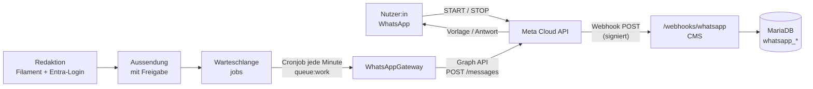
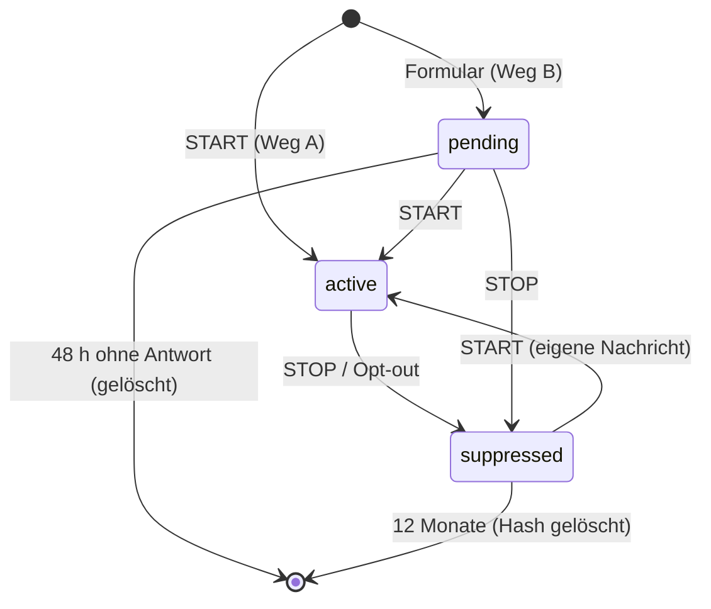

# Pflichtenheft: WhatsApp-Newsletter (KDG-konform)

**Stand:** 4. Oktober 2026 · **Status:** umgesetzt (Version 1), Livegang nach Freigabe durch DSB und Budget · **Bezug:** Pflichtenheft (docs/pflichtenheft.md) Kap. 5 (Rechte), 6.6 (Georgsbrief), 6.10 (Mailversand), 9 (KDG), 10 (Betrieb)

Ein zusätzlicher Newsletter-Kanal über WhatsApp, versendet über die Büro-Festnetznummer des Diözesanbüros und gesteuert aus dem bestehenden CMS (Laravel 12, Filament 4, MariaDB, Webspace mit Cronjob).

---

## Umsetzungsstand (Version 1)

Umgesetzt wie unten beschrieben, vollständig auf dem Webspace (PHP, Cronjob, Datenbank-Warteschlange). Abweichungen und Präzisierungen:
- Kein eigener `FakeGateway`: Tests simulieren die Graph API mit `Http::fake` (wie bei Instagram). Der Client heißt `App\Services\WhatsApp\WhatsAppClient`.
- Rufnummern werden ohne Zusatzpaket normalisiert (`App\Support\PhoneNumber`); der QR-Code ist ein statisches SVG (`public/images/whatsapp/anmelden-qr.svg`, neu erzeugen mit `scripts/whatsapp-qr.py`, ein Test prüft die Nummer). **Keine neuen Composer- oder NPM-Pakete.**
- Rolle `whatsapp` („WhatsApp-Newsletter-Admin“): ganzes Modul inkl. Verbindung; Verwaltung ohne Verbindung; Vorstand nur Entwürfe.
- Backend: Navigationsgruppe „WhatsApp-Newsletter“ mit Aussendungen, Vorlagen, Abonnent:innen und Verbindung (`/admin/whatsapp/…`).
- Befehle: `whatsapp:check` (stündlich, auch über „Server-Prüfung“), `whatsapp:prune` (täglich), `whatsapp:dispatch-scheduled` (jede Minute).

## 0. Kurzfassung und offene Entscheidungen

**Technischer Weg:** offizielle **WhatsApp Cloud API** von Meta. Das CMS spricht sie über einen austauschbaren Treiber an, damit später auch ein Business Solution Provider (BSP) nutzbar ist. Es gibt kein Smartphone, keine WhatsApp-App und damit keinen Zugriff auf Adressbücher. Die Festnetznummer wird per Sprachanruf verifiziert.

**Datenschutz:** Double-Opt-In mit dem Schlüsselwort `START`, Abmeldung jederzeit mit `STOP`. Gespeichert werden nur die Telefonnummer (verschlüsselt) und die Nachweise der Einwilligung. Keine Namen, keine Profilbilder, keine Nachrichteninhalte.

**Vor der Umsetzung zu entscheiden** (Blocker, Abschnitt 11):

| # | Frage | Warum entscheidend |
|---|---|---|
| E1 | Freigabe durch die/den Diözesandatenschutzbeauftragte:n (inkl. Datenschutz-Folgenabschätzung) | Kirchliche Datenschutzaufsichten sehen WhatsApp für dienstliche Kommunikation traditionell kritisch. Die Cloud API mit Einwilligung ist ein anderer Fall als die App, muss aber vorab geklärt werden. |
| E2 | Budget | Jede Newsletter-Nachricht ist bei Meta eine kostenpflichtige **Marketing-Vorlage**: in Deutschland grob 0,10–0,15 € je zugestellter Nachricht (Preisliste vor Start prüfen). Bei 500 Abonnent:innen und zwei Ausgaben im Monat sind das rund 100–150 € im Monat. |
| E3 | Rechtsträger und Zahlungsmittel | Das Meta-Business-Konto braucht ein verifiziertes Unternehmen (Vereinsregister) und eine Kreditkarte oder ein anderes Zahlungsmittel. |
| E4 | Mindestalter | Einwilligung nach KDG ab 16 Jahren. Jüngere brauchen die Zustimmung der Eltern und sind im ersten Schritt ausgeschlossen. |
| E5 | Kostenfreie Alternative WhatsApp-Kanal | Ein WhatsApp-Kanal kostet nichts und zeigt dem Verband **keine** Nummern. Er hat aber keine API, gepostet wird von Hand in der App (siehe 1.3). |

---

## 1. Ziel und Abgrenzung

### 1.1 Ziel
- Kurze Hinweise (neue Beiträge, Anmeldestart, Georgsbote erschienen) erreichen Interessierte dort, wo sie lesen: in WhatsApp.
- Pflege und Versand aus dem CMS, mit Freigabe und Protokoll wie bei Beiträgen.
- KDG-konform: Einwilligung nachweisbar, Abmeldung sofort wirksam, so wenig Daten wie möglich.

### 1.2 Nicht im Umfang
- Keine Zweiwege-Kommunikation und kein Chat-Postfach im CMS. Eingehende Nachrichten außer Schlüsselwörtern werden nicht gespeichert, sondern einmal je 24 Stunden mit einem Hinweis auf E-Mail und Telefon beantwortet.
- Keine Gruppen, keine Zielgruppen-Segmente in Version 1 (siehe 12. Ausblick).
- Keine Nutzung der Nummer in der normalen WhatsApp- oder WhatsApp-Business-App.

### 1.3 Geprüfte Alternative: WhatsApp-Kanal
| | Cloud API (dieses Pflichtenheft) | WhatsApp-Kanal |
|---|---|---|
| Kosten | je Nachricht (Marketing-Vorlage) | keine |
| Nummern der Abonnent:innen | im CMS gespeichert (verschlüsselt) | für den Verband **nicht sichtbar** |
| Einwilligung, Abmeldung | DOI und STOP, im CMS nachweisbar | „Folgen“ bzw. „Nicht mehr folgen“ in der App |
| CMS-Anbindung | voll (Freigabe, Versand, Statistik) | keine API; Posten von Hand über ein Smartphone mit WhatsApp |
| Persönliche Ansprache, Erinnerungen | möglich | nein, nur Ein-Weg-Broadcast |

**Empfehlung:** Mit dem DSB auch den Kanal besprechen. Für reine Hinweise ist er datensparsamer und kostenlos. Die Cloud-API-Lösung lohnt sich, wenn Versand aus dem CMS, Freigabe und Nachweis gebraucht werden.

---

## 2. Rechtlicher Rahmen (KDG) – Anforderungen an das Modul

| ID | Anforderung | Prio |
|---|---|---|
| F-WA-DS-01 | Rechtsgrundlage ist die Einwilligung (§ 6 Abs. 1 lit. b, § 8 KDG). Gespeichert werden Zeitpunkt der Anfrage, Zeitpunkt der Bestätigung, Kanal (Formular/Link) und Version des Einwilligungstextes. | M |
| F-WA-DS-02 | Mindestalter 16 (§ 8 Abs. 8 KDG): Formular mit Pflicht-Häkchen; beim Link-Weg Hinweis direkt am QR-Code und in der Willkommensnachricht. | M |
| F-WA-DS-03 | Datenminimierung: nur Telefonnummer und Einwilligungsnachweis. **Profilname und Profilbild aus den Webhook-Daten werden sofort verworfen und nie gespeichert oder protokolliert.** | M |
| F-WA-DS-04 | Abmeldung per `STOP` (und Synonymen) wird sofort wirksam: Datensatz löschen, Nummer nur als Hash in einer Sperrliste (siehe 5.2). | M |
| F-WA-DS-05 | Auskunft und Löschung über die bestehenden „Datenschutz-Anfragen“ im Backend, Suche zusätzlich per Telefonnummer. | M |
| F-WA-DS-06 | Auftragsverarbeitung (§ 29 KDG): WhatsApp Business Terms / Data Processing Terms von Meta Platforms Ireland Ltd. akzeptieren und dokumentieren; Drittlandübermittlung USA über den EU-US Data Privacy Framework (§ 40 KDG). | M |
| F-WA-DS-07 | Datenschutz-Folgenabschätzung (§ 35 KDG) vor Inbetriebnahme, Eintrag im Verzeichnis der Verarbeitungstätigkeiten (§ 31 KDG). | M |
| F-WA-DS-08 | Datenschutzerklärung um den Abschnitt in 2.1 ergänzen; Link in jeder Willkommens- und Bestätigungsnachricht. | M |
| F-WA-DS-09 | Keine Lesebestätigungen auswerten: Statistik nur „gesendet / zugestellt / fehlgeschlagen“ als Summe je Aussendung. | M |
| F-WA-DS-10 | Ausstehende (unbestätigte) Anmeldungen nach 48 Stunden löschen, wie bei Veranstaltungsanmeldungen. | M |

> Die Paragrafenangaben beziehen sich auf das KDG in der Fassung von 2018. Vor Veröffentlichung mit der/dem DSB abgleichen.

### 2.1 Textbaustein für die Datenschutzerklärung (Entwurf)

> **WhatsApp-Newsletter.** Wenn du unseren WhatsApp-Newsletter abonnierst, verarbeiten wir deine Mobilnummer und den Zeitpunkt deiner Einwilligung, um dir Nachrichten zu schicken. Rechtsgrundlage ist deine Einwilligung (§ 6 Abs. 1 lit. b KDG), die du jederzeit mit der Nachricht „STOP“ widerrufen kannst.
> Für den Versand nutzen wir die WhatsApp Business Platform (Cloud API) der Meta Platforms Ireland Ltd. als Auftragsverarbeiter. Dabei fallen bei Meta **Metadaten** an (z. B. wer wann mit welcher Nummer kommuniziert, Geräte- und Verbindungsdaten). Diese können auch in die USA übermittelt werden (Grundlage: EU-US Data Privacy Framework). Die Inhalte sind auf dem Übertragungsweg verschlüsselt. Bei der Cloud API werden sie auf Servern von Meta im Auftrag entschlüsselt, um sie an unsere Website weiterzuleiten bzw. von ihr zu versenden. Meta verwendet die Inhalte nach eigenen Angaben nicht für Werbung.
> Wir speichern keine Namen und keine Profilbilder. Nach deiner Abmeldung löschen wir deine Nummer und behalten nur einen nicht umkehrbaren Prüfwert, damit du keine weiteren Nachrichten bekommst.

**Hinweis zur Technik:** Die Formulierung „Inhalte bleiben Ende-zu-Ende-verschlüsselt“ wäre bei der Cloud API **falsch**, weil Meta dort selbst der Endpunkt ist. Der Textbaustein berücksichtigt das.

---

## 3. Architektur

### 3.1 Überblick



### 3.2 Komponenten im CMS

| Komponente | Laravel-Baustein | Aufgabe |
|---|---|---|
| `App\Services\WhatsApp\WhatsAppGateway` (Interface) | Service | `sendTemplate()`, `sendText()`, `templates()`, `createTemplate()`, `phoneStatus()` |
| `MetaCloudGateway` | Treiber | Graph API über den Laravel-HTTP-Client (Guzzle, schon vorhanden) |
| `FakeGateway` | Treiber | Tests und Testumgebung ohne Meta (wie der simulierte Instagram-Client) |
| `WebhookController` | Controller | Verifizierung, Signaturprüfung, Weitergabe an `InboundHandler` |
| `InboundHandler` | Service | Schlüsselwörter, DOI-Zustandsautomat, Status-Updates |
| `SendCampaignMessage` | Queued Job | ein Empfänger je Job, mit Rate-Limit `whatsapp`, Wiederholung |
| `Subscriber`, `Campaign`, `Template`, `Delivery`, `Suppression` | Eloquent-Modelle | siehe 5. |
| Filament: `WhatsAppSubscribers`, `WhatsAppTemplates`, `WhatsAppCampaigns` | Ressourcen | Backend (siehe 7.) |
| Health-Check `whatsapp` | `HealthChecks` | Token gültig, Nummer verbunden, Qualitätsbewertung, Limit-Stufe |
| Zugangsdaten | `IntegrationToken` (verschlüsselt) + Seite „Integrationen“ | Token nie wieder angezeigt, nur Admin |

### 3.3 Betriebsrahmen (Webspace)
- **Verbindliche Vorgabe:** Das Modul läuft vollständig auf dem bestehenden Webspace (Plesk, PHP, MariaDB, Cronjob). Kein Node.js, keine NPM-Pakete zur Laufzeit, keine Docker-Container, kein zusätzlicher Server oder Dienst. Was sich so nicht umsetzen lässt, gehört nicht in dieses Modul.
- Neue Abhängigkeiten nur als reine PHP-Pakete über Composer. Sie werden wie bisher im GitHub-Workflow gebaut und als `vendor/` hochgeladen; auf dem Server läuft kein Installer.
- Es gibt keine dauerhaft laufenden Prozesse. Der Versand läuft über die vorhandene **Datenbank-Warteschlange** und den Cronjob `queue:work --stop-when-empty --max-time=50` jede Minute. Bei etwa 1–3 Nachrichten pro Sekunde (HTTP-Laufzeit) sind das grob 60–150 Empfänger je Minute; 1.000 Abonnent:innen sind also in etwa 10 Minuten durch.
- Der Webhook antwortet sofort und verarbeitet synchron nur kleine Datenbank-Operationen. Ausgehende Antworten (Willkommen, Bestätigung) laufen über die Warteschlange.
- **Testumgebung:** Eine Nummer kann nur **eine** Webhook-URL haben. test.dpsg-trier.de nutzt deshalb die kostenlose **Testnummer** von Meta (sendet nur an bis zu 5 hinterlegte Empfänger), die Büro-Festnetznummer nur die Produktion. Zusätzlich gibt es `WHATSAPP_TEST_ALLOWLIST` analog zur Mail-Testumleitung: Nachrichten an andere Nummern werden im Test verworfen und protokolliert.

### 3.4 Treiber-Wahl Cloud API oder BSP

| | Meta Cloud API direkt | BSP (z. B. Brevo, Sinch/MessengerPeople, superchat) |
|---|---|---|
| Kosten | nur Meta-Gebühren | Meta-Gebühren + Plattformgebühr |
| Auftragsverarbeitung | Meta | Meta **und** BSP (zusätzlicher AV-Vertrag; bei Brevo besteht bereits einer) |
| Einrichtung | selbst (Abschnitt 9) | mit Unterstützung des Anbieters |
| Aufwand im CMS | Treiber `MetaCloudGateway` | eigener Treiber je Anbieter |

**Empfehlung:** Cloud API direkt. Das Interface hält die Tür für einen BSP offen, falls die Einrichtung bei Meta scheitert.

---

## 4. Ablauf: Anmeldung, Bestätigung, Abmeldung

### 4.1 Weg A: QR-Code / wa.me-Link (empfohlen, Standard)
1. Die Landingpage `/whatsapp` (sowie Flyer und Plakate) zeigt die Einwilligungsinformationen, den Hinweis „ab 16 Jahren“ und QR-Code und Link:
   `https://wa.me/4965146298290?text=START`
   (+49 651 4629829-0, Büro-Festnetz; vor Start prüfen)
2. Die Person sendet `START` **von ihrem eigenen Gerät**. Damit sind Rufnummer und Wille zugleich bestätigt, und es öffnet sich das 24-Stunden-Servicefenster (kostenlose Antworten).
3. Das CMS legt den Abonnenten **aktiv** an (`confirmed_at` = Eingang von START, `source = link`) und antwortet mit der Willkommensnachricht: was kommt, wie oft, Datenschutz-Link, „Abmelden: STOP“.

*Begründung:* Die Nachricht kommt nachweislich vom Inhaber der Nummer und erfolgt aktiv. Das erfüllt den Zweck des Double-Opt-In (kein Eintragen fremder Nummern) ohne Vorlage und ohne Kosten. Die Einordnung als DOI ist mit der/dem DSB zu bestätigen (E1).

### 4.2 Weg B: Formular mit Rufnummer (Pflichtenheft-Variante, optional)
1. Im Formular `/whatsapp` gibt die Person ihre Nummer ein und setzt die Häkchen Einwilligung und „Ich bin mindestens 16“. Spamschutz wie beim Kontaktformular (Honeypot, Zeitprüfung, Rate-Limit je IP und je Nummer).
2. Das CMS legt einen Datensatz `pending` an und schickt die **DOI-Vorlage** (Kategorie *Utility*): „Bitte bestätige deine Anmeldung zum WhatsApp-Newsletter der DPSG Trier mit START. Hast du dich nicht angemeldet, ignoriere diese Nachricht.“
3. Erst nach der Antwort `START` wird der Datensatz `active`. Ohne Antwort wird er nach 48 h gelöscht.
4. Missbrauchsschutz: höchstens **eine** DOI-Vorlage je Nummer in 30 Tagen; Nummern auf der Sperrliste bekommen keine Vorlage (die Seite antwortet trotzdem gleich, um nichts zu verraten).

*Risiko:* Jede DOI-Vorlage kostet Geld und kann an fremde Nummern gehen. Ein Fehlversand wirkt wie Spam und senkt die Qualitätsbewertung bei Meta. Weg B deshalb nur einschalten, wenn Weg A nicht reicht (Konfigurationsschalter `whatsapp.form_doi`).

### 4.3 Schlüsselwörter (Eingang)
Normalisierung: Leerzeichen und Satzzeichen entfernen, Großschreibung; „Start!“, „ start“ gelten als START.

| Eingang | Zustand vorher | Aktion | Antwort (Servicenachricht, kostenlos) |
|---|---|---|---|
| `START`, `ANMELDEN` | keiner | aktiv anlegen (Weg A) | Willkommen + Datenschutz + STOP-Hinweis |
| `START`, `ANMELDEN` | pending (Weg B) | aktiv setzen | Willkommen |
| `START` | aktiv | nichts | „Du bist schon angemeldet.“ |
| `START` | gesperrt (früher STOP) | Sperre aufheben, aktiv anlegen | Willkommen |
| `STOP`, `STOPP`, `ABMELDEN`, `ENDE`, `ABBESTELLEN` | aktiv oder pending | löschen, Hash in Sperrliste | „Du bist abgemeldet. Mit START kannst du dich wieder anmelden.“ |
| `STOP` | keiner | Hash in Sperrliste | dieselbe Bestätigung |
| Button „Werbung stoppen“ von Meta / Status „Nutzer hat Marketing abbestellt“ | beliebig | wie STOP | keine |
| sonstiger Text, Bild, Sprachnachricht | beliebig | **nicht speichern** | höchstens 1× je 24 h: „Hier kommt nur der Newsletter an. Fragen bitte an info@dpsg-trier.de oder 0651 4629829-0.“ |

### 4.4 Zustandsautomat



---

## 5. Datenmodell (MariaDB, Laravel-Migrationen)

### 5.1 `whatsapp_subscribers`
| Spalte | Typ | Zweck |
|---|---|---|
| `id` | bigint PK | |
| `phone` | text, **encrypted cast** | Nummer im E.164-Format, nur verschlüsselt in der DB |
| `phone_hash` | char(64), unique | HMAC-SHA256(E.164, Schlüssel aus `APP_KEY`), für Suche und Webhook-Zuordnung ohne Entschlüsselung |
| `status` | enum `pending`, `active` | |
| `source` | enum `link`, `form` | Nachweis des Weges |
| `consent_version` | varchar(20) | Version des Einwilligungstextes (z. B. `2026-10`) |
| `requested_at` | timestamp null | Formular abgeschickt (nur Weg B) |
| `confirmed_at` | timestamp null | **DOI-Zeitstempel** |
| `last_inbound_at` | timestamp null | Beginn des 24-h-Servicefensters (nur technisch, keine Inhalte) |
| `failed_streak` | tinyint | Fehlversuche in Folge (Nummer nicht mehr bei WhatsApp) |
| `created_at`, `updated_at` | | |

Bewusst **nicht** gespeichert: Profilname, Profilbild, Nachrichteninhalte, Lesebestätigungen, Gerätedaten.

### 5.2 `whatsapp_suppressions`
| Spalte | Typ | Zweck |
|---|---|---|
| `phone_hash` | char(64) PK | gleicher HMAC wie oben, nicht umkehrbar ohne Schlüssel |
| `reason` | enum `stop`, `meta_optout`, `invalid` | |
| `created_at` | timestamp | Löschung nach 12 Monaten (täglicher Befehl) |

### 5.3 `whatsapp_templates`
| Spalte | Typ | Zweck |
|---|---|---|
| `id` | bigint PK | |
| `meta_id` | varchar | ID bei Meta |
| `name`, `language` | varchar | z. B. `dpsg_news_v1`, `de` |
| `category` | enum `MARKETING`, `UTILITY` | |
| `purpose` | enum `doi`, `newsletter` | Verwendung im CMS |
| `status` | enum `PENDING`, `APPROVED`, `REJECTED`, `PAUSED`, `DISABLED` | per Webhook und Abgleich |
| `components` | json | Kopf, Text mit Platzhaltern `{{1}}`, Fußzeile, Buttons |
| `quality` | varchar null | Bewertung von Meta |
| `rejected_reason` | text null | |
| `synced_at` | timestamp | |

### 5.4 `whatsapp_campaigns` (Aussendungen)
| Spalte | Typ | Zweck |
|---|---|---|
| `id` | bigint PK | |
| `title` | varchar | intern |
| `template_id` | FK | nur `APPROVED` + `newsletter` |
| `variables` | json | Werte für `{{1}}` … und URL-Button |
| `post_id` | FK null | optional verknüpfter Beitrag (Link) |
| `status` | enum `draft`, `review`, `approved`, `scheduled`, `sending`, `sent`, `cancelled`, `failed` | |
| `scheduled_at` | timestamp null | |
| `created_by`, `approved_by` | FK users | |
| `approved_at`, `started_at`, `finished_at` | timestamp | |
| `recipients`, `sent`, `delivered`, `failed` | int | **nur Summen** |
| `estimated_cost_eur` | decimal(8,2) | Anzeige vor Freigabe |

### 5.5 `whatsapp_deliveries` (kurzlebig)
| Spalte | Typ | Zweck |
|---|---|---|
| `id` | bigint PK | |
| `campaign_id` | FK | |
| `subscriber_id` | FK null, `nullOnDelete` | |
| `wamid` | varchar unique | Nachrichten-ID von Meta, Zuordnung der Status-Webhooks |
| `status` | enum `queued`, `sent`, `delivered`, `failed` | `read` wird ignoriert |
| `error_code` | int null | |
| `created_at`, `updated_at` | | |

Einträge werden **30 Tage** nach Abschluss der Aussendung gelöscht; die Summen in `whatsapp_campaigns` bleiben.

---

## 6. Schnittstellen

### 6.1 Eingehend (Webhook)
| Methode | Route | Zweck | Schutz |
|---|---|---|---|
| GET | `/webhooks/whatsapp` | Verifizierung: bei `hub.mode=subscribe` und passendem `hub.verify_token` wird `hub.challenge` als Klartext zurückgegeben, sonst 403 | Verify-Token (zufällig, 32+ Zeichen, verschlüsselt gespeichert) |
| POST | `/webhooks/whatsapp` | Nachrichten (`messages`), Zustellstatus (`statuses`), Vorlagenstatus (`message_template_status_update`), Qualität (`phone_number_quality_update`), Konto (`account_update`) | **`X-Hub-Signature-256`** = `sha256=` + HMAC-SHA256(**roher Body**, App-Secret), Vergleich mit `hash_equals`; ohne gültige Signatur 403 |

Anforderungen:
- **F-WA-API-01 (M):** Route ohne CSRF-Prüfung, eigenes Rate-Limit (`throttle:whatsapp-webhook`, z. B. 600/min), außerhalb der Session-Middleware.
- **F-WA-API-02 (M):** Antwort `200` innerhalb von 3 Sekunden, auch bei unbekannten Ereignissen. Meta wiederholt sonst die Zustellung.
- **F-WA-API-03 (M):** Idempotenz: Nachrichten-ID (`messages[].id`) 48 h im Cache, doppelte Ereignisse werden übersprungen.
- **F-WA-API-04 (M):** Es werden **keine Rohdaten** protokolliert, nur Ereignistyp und Ergebnis. `contacts[].profile.name` wird nie gelesen.
- **F-WA-API-05 (S):** Ereignisse für Vorlagen, Qualität und Konto lösen bei Problemen eine Mail und Push-Nachricht (ntfy, Ereignis „Störungen“) an die Admins aus.

Beispiel (gekürzt) – eingehendes `START`:
```json
{ "object": "whatsapp_business_account",
  "entry": [{ "changes": [{ "field": "messages", "value": {
    "metadata": { "phone_number_id": "1234567890" },
    "contacts": [{ "wa_id": "4915112345678", "profile": { "name": "— wird verworfen —" } }],
    "messages": [{ "from": "4915112345678", "id": "wamid.HBg…", "timestamp": "1791100000",
                   "type": "text", "text": { "body": "START" } }] } }] }] }
```

### 6.2 Ausgehend (Graph API, Version konfigurierbar, z. B. `v21.0`)
| Zweck | Aufruf |
|---|---|
| Vorlage senden | `POST /{phone-number-id}/messages` mit `type: template`, `template.name`, `language.code: de`, `components` (Parameter) |
| Text im Servicefenster | `POST /{phone-number-id}/messages` mit `type: text` (nur < 24 h nach letzter Nachricht der Person) |
| Vorlagen lesen / anlegen | `GET` / `POST /{waba-id}/message_templates` |
| Nummernstatus, Qualität, Limit | `GET /{phone-number-id}?fields=display_phone_number,verified_name,quality_rating,messaging_limit_tier,status` |
| App am Konto abonnieren | `POST /{waba-id}/subscribed_apps` |
| Nummer registrieren (einmalig) | `POST /{phone-number-id}/register` mit 6-stelliger PIN |

Fehlerbehandlung (Auszug, Codes vor Umsetzung gegen die aktuelle Meta-Doku prüfen):
| Fall | Verhalten |
|---|---|
| Durchsatz-Limit (z. B. 130429), Paar-Limit (131056) | Job mit Verzögerung neu einreihen (Backoff 30 s → 5 min) |
| Spam-Limit / Konto eingeschränkt (z. B. 131048, 368) | **Aussendung anhalten**, Admins alarmieren |
| Empfänger nicht erreichbar (z. B. 131026) | `failed`, `failed_streak + 1`; ab 3 in Folge Abonnent löschen |
| Marketing abgelehnt / Nutzer hat abbestellt | wie STOP behandeln |
| Token ungültig (190) | Aussendung anhalten, Health-Check rot, Admins alarmieren |

### 6.3 Öffentliche Routen (Frontend)
| Route | Zweck |
|---|---|
| `GET /whatsapp` | Landingpage: Nutzen, Häufigkeit, Datenschutz, ab 16, QR-Code + Link (Weg A), optional Formular (Weg B) |
| `POST /whatsapp` | nur bei Weg B: Formular, Antwort immer gleich („Prüfe dein WhatsApp“) |
| `GET /whatsapp/qr.svg` | QR-Code als SVG, serverseitig erzeugt, für Flyer herunterladbar |

---

## 7. Funktionen im Backend

### 7.1 Rechte
| Funktion | Autor:in | Stufen-/Sektionsadmin | Vorstand | Verwaltung | Admin |
|---|:-:|:-:|:-:|:-:|:-:|
| Aussendung entwerfen | – | ● | ● | ● | ● |
| Aussendung freigeben und versenden | – | – | ● | ● | ● |
| Abonnent:innen sehen (Anzahl, Nummern maskiert) | – | – | Anzahl | ● | ● |
| Abonnent:in löschen | – | – | – | ● | ● |
| Vorlagen anlegen und abgleichen | – | – | – | ● | ● |
| Zugangsdaten, Webhook, Nummer | – | – | – | – | ● |

Anmeldung wie im ganzen Backend über Entra ID (M365). Freigeben darf nicht dieselbe Person, die entworfen hat (Vier-Augen-Prinzip, abschaltbar für Verwaltung).

### 7.2 Anforderungen
| ID | Anforderung | Prio |
|---|---|---|
| F-WA-01 | Ressource „WhatsApp-Aussendungen“: Vorlage wählen, Platzhalter füllen (mit Zeichenzähler und Live-Vorschau im WhatsApp-Stil), optional Beitrag verknüpfen (füllt Titel und Link vor) | M |
| F-WA-02 | Vor der Freigabe Anzeige: Empfängerzahl, geschätzte Kosten (Preis aus Konfiguration), aktuelles Limit der Nummer; Freigabe gesperrt, wenn das Limit überschritten wird | M |
| F-WA-03 | Freigabe-Workflow: Entwurf → zur Prüfung → freigegeben → (geplant) → Versand; jeder Schritt im Audit-Log; Push/Mail an Freigebende | M |
| F-WA-04 | Versand-Engine: ein Job je Empfänger über die Warteschlange, Rate-Limiter `whatsapp` (konfigurierbar, Standard 60/min), Wiederholung bei Limits, Anhalten und Fortsetzen möglich | M |
| F-WA-05 | Testversand an eine einzelne hinterlegte Nummer der freigebenden Person vor dem echten Versand | S |
| F-WA-06 | Ergebnis je Aussendung: gesendet, zugestellt, fehlgeschlagen (Summen) | M |
| F-WA-07 | Ressource „WhatsApp-Vorlagen“: Abgleich mit Meta, Status-Anzeige, neue Vorlage anlegen (Name, Kategorie, Text mit Platzhaltern, Fußzeile „Abmelden: STOP“, Button „Mehr lesen“ mit URL-Platzhalter) | M |
| F-WA-08 | Abonnent:innen: Anzahl aktiv/ausstehend, Verlauf je Monat; Liste mit maskierten Nummern (`+49 151 ••••• 678`), Suche über Hash, Löschen; **kein Export** | M |
| F-WA-09 | Integrationen (nur Admin): Token, App-Secret, Phone-Number-ID, WABA-ID, Verify-Token (erzeugen), Graph-Version; Button „Webhook abonnieren“ und „Verbindung prüfen“ | M |
| F-WA-10 | Health-Check auf /status: grau wenn nicht eingerichtet, gelb bei Qualität „mittel“ oder Vorlage pausiert, rot bei ungültigem Token oder gesperrter Nummer | M |
| F-WA-11 | Datenschutz-Anfragen: Suche auch per Telefonnummer; Auskunft (Status, Zeitstempel, Herkunft, Einwilligungsversion) und Löschung | M |
| F-WA-12 | Automatische Aussendung „neuer Beitrag“ als Vorschlag (Entwurf), nie ohne Freigabe | K |

### 7.3 Vorlagen (Startausstattung)
| Name | Kategorie | Text (Entwurf) |
|---|---|---|
| `dpsg_doi_v1` | Utility | „Hallo! Bitte bestätige deine Anmeldung zum WhatsApp-Newsletter der DPSG Trier: Antworte mit START. Warst du das nicht? Dann ignoriere diese Nachricht.“ |
| `dpsg_news_v1` | Marketing | „Neues aus dem DPSG Diözesanverband Trier: {{1}}“ · Button „Mehr lesen“ → `https://dpsg-trier.de/{{1}}` · Fußzeile „Abmelden: STOP antworten“ |
| `dpsg_event_v1` | Marketing | „Anmeldung offen: {{1}} am {{2}}. Alle Infos und Anmeldung:“ · Button URL · Fußzeile wie oben |

Meta lehnt Vorlagen ab, die nur aus Platzhaltern bestehen. Feste Textteile sind deshalb Pflicht.

---

## 8. Sicherheit und Betrieb

| ID | Anforderung | Prio |
|---|---|---|
| F-WA-SEC-01 | Zugangsdaten nur verschlüsselt in `integration_tokens` bzw. als GitHub-Secret/`.env`; nie im Repository, nie in Mails oder Chats | M |
| F-WA-SEC-02 | Dauerhafter Token eines **Systembenutzers** (nicht eines persönlichen Facebook-Kontos) mit nur `whatsapp_business_messaging` und `whatsapp_business_management` | M |
| F-WA-SEC-03 | Signaturprüfung mit App-Secret, Vergleich in konstanter Zeit; Verify-Token zufällig | M |
| F-WA-SEC-04 | Rufnummern-Validierung und E.164-Normalisierung serverseitig (libphonenumber) | M |
| F-WA-SEC-05 | Nummern im Klartext nur im Speicher während Versand; Logs ohne Nummern (höchstens die letzten 3 Ziffern) | M |
| F-WA-OPS-01 | Täglicher Befehl `whatsapp:prune`: ausstehende Anmeldungen > 48 h, Zustellungen > 30 Tage, Sperrliste > 12 Monate | M |
| F-WA-OPS-02 | Befehl `whatsapp:check` (auch über den Workflow „Server-Prüfung“): Token, Nummer, Qualität, Limit, Vorlagenstatus | M |
| F-WA-OPS-03 | Backups enthalten die Tabellen; die Nummern sind darin verschlüsselt | M |
| F-WA-OPS-04 | Tests mit `FakeGateway` und Http::fake: Signatur, Verifizierung, DOI, STOP, Sperrliste, Versand mit Limits, Datenminimierung (Profilname wird nicht gespeichert) | M |

---

## 9. Setup-Anleitung für Admins

Dauer etwa 1–2 Stunden Arbeit plus Wartezeit für die Prüfungen durch Meta (Unternehmensverifizierung meist wenige Tage). Vorher erledigt sein müssen E1 (DSB) und E3 (Rechtsträger, Zahlungsmittel).

### Schritt 1 – Voraussetzungen klären
1. Wer verwaltet das Meta-Konto? Meta verlangt echte Personen mit eigenem Facebook- oder Meta-Konto als Admins. **Mindestens zwei Admins** eintragen (Vertretung), z. B. Büro und Technik.
2. Unterlagen bereitlegen: Vereinsregisterauszug des Rechtsträgers, ein Dokument mit Name und Anschrift (z. B. Freistellungsbescheid oder Rechnung), Zugriff auf die Website (Domain-Verifizierung).
3. Festnetznummer prüfen:
   - Sie darf **nicht** in der WhatsApp-App oder WhatsApp-Business-App registriert sein. Falls doch: dort zuerst das Konto löschen (Einstellungen → Konto → Konto löschen).
   - Die Telefonanlage muss einen Anruf aus dem Ausland bzw. mit unterdrückter Nummer **direkt** durchstellen: Sprachmenü und Warteschleife für den Termin abschalten oder auf eine Durchwahl legen.
   - Jemand muss am Telefon sein und den angesagten Code notieren.

### Schritt 2 – Meta-Business-Portfolio anlegen
1. https://business.facebook.com → „Konto erstellen“.
2. Name **genau wie im Vereinsregister**, Anschrift Weberbach 71, 54290 Trier, Website `https://dpsg-trier.de`, geschäftliche E-Mail (z. B. info@dpsg-trier.de).
3. Zweite:n Admin einladen: Einstellungen → Personen → Hinzufügen → „Vollständige Kontrolle“.

### Schritt 3 – Unternehmen verifizieren
1. Einstellungen → Sicherheitscenter → **Unternehmensverifizierung starten**.
2. Rechtlichen Namen, Anschrift und Telefonnummer angeben; Vereinsregisterauszug und Adressnachweis hochladen.
3. **Domain bestätigen** (Einstellungen → Markensicherheit → Domains): entweder ein DNS-TXT-Eintrag beim Hoster oder ein Meta-Tag. Das Meta-Tag kann das CMS ausgeben (Feld in „Integrationen“).
4. Bestätigung abwarten (E-Mail von Meta). Ohne Verifizierung bleibt das Versandlimit sehr niedrig.

### Schritt 4 – App und WhatsApp-Konto anlegen
1. https://developers.facebook.com → „Meine Apps“ → **App erstellen** → Typ „Business“ → dem Portfolio aus Schritt 2 zuordnen.
2. In der App **WhatsApp** hinzufügen. Meta legt ein WhatsApp-Business-Konto (WABA) und eine kostenlose **Testnummer** an. Diese nutzt test.dpsg-trier.de (siehe 3.3).
3. Im App-Dashboard unter Einstellungen → Allgemein: **Datenschutz-URL** `https://dpsg-trier.de/datenschutz`, Kategorie, App-Symbol eintragen. Das **App-Secret** notieren, es wird in Schritt 8 ins CMS eingetragen.

### Schritt 5 – Festnetznummer hinzufügen und per Anruf verifizieren
1. WhatsApp Manager (https://business.facebook.com/wa/manage) → **Telefonnummern** → „Telefonnummer hinzufügen“.
2. **Anzeigename:** z. B. „DPSG Trier“. Er muss zum Unternehmen passen, Meta prüft ihn. Kategorie „Gemeinnützige Organisation“, kurze Beschreibung.
3. **Nummer:** Land Deutschland (+49), Nummer **ohne führende 0**: `651 46298290`.
4. Verifizierungsmethode **„Telefonanruf“** wählen (SMS geht beim Festnetz nicht). Eine Bandansage nennt einen **6-stelligen Code**; ihn eintragen. Falls kein Anruf kommt: Telefonanlage prüfen (Schritt 1.3) und nach einigen Minuten erneut anfordern.
5. **Zwei-Schritt-Verifizierung:** eine 6-stellige **PIN** festlegen. Sie wird für die Registrierung über die API gebraucht und bei späteren Umzügen. Die PIN offline sicher verwahren (wie den Notfallzugang).
6. Anzeigename-Prüfung abwarten (Status „Genehmigt“).

### Schritt 6 – Zahlungsmittel hinterlegen
WhatsApp Manager → Kontoeinstellungen → **Zahlungsmethoden** → Kreditkarte oder Lastschrift des Rechtsträgers hinzufügen und Währung EUR wählen. Ohne Zahlungsmittel lassen sich keine Marketing-Vorlagen versenden.

### Schritt 7 – Systembenutzer und dauerhaften Token erzeugen
1. Business-Einstellungen → Nutzer → **Systembenutzer** → Hinzufügen, Name z. B. „CMS dpsg-trier.de“, Rolle „Mitarbeiter“.
2. **Assets zuweisen:** die App (Vollzugriff) und das WhatsApp-Konto (Vollzugriff).
3. **Token generieren:** App auswählen, Ablauf **„Nie“**, Berechtigungen nur `whatsapp_business_messaging` und `whatsapp_business_management`.
4. Den Token **sofort** im CMS eintragen (Schritt 8) und nirgends sonst speichern, auch nicht per Mail oder Chat.

### Schritt 8 – Zugangsdaten im CMS eintragen
Backend → **Integrationen** → WhatsApp (nur Admin):
- Token (aus Schritt 7), App-Secret (Schritt 4.3), **Phone-Number-ID** und **WABA-ID** (WhatsApp Manager → Telefonnummern → Nummer anklicken).
- „Verify-Token erzeugen“ klicken und den angezeigten Wert kopieren (er wird nur dieses eine Mal gezeigt).
- „Nummer registrieren“ klicken: das CMS ruft `/register` mit der PIN aus Schritt 5.5 auf; die PIN wird dafür einmalig abgefragt und nicht gespeichert.

### Schritt 9 – Webhook verbinden
1. App-Dashboard → WhatsApp → **Konfiguration** → Webhook bearbeiten:
   - Callback-URL: `https://dpsg-trier.de/webhooks/whatsapp`
   - Verifizierungstoken: Wert aus Schritt 8
   - „Bestätigen und speichern“: Meta ruft die GET-Route auf, das CMS antwortet mit der Challenge.
2. **Webhook-Felder abonnieren:** `messages`, `message_template_status_update`, `phone_number_quality_update`, `account_update`.
3. Im CMS „Webhook abonnieren“ klicken. Das verknüpft die App mit dem WhatsApp-Konto (`subscribed_apps`).
4. App in den **Live-Modus** schalten (oben im App-Dashboard).

### Schritt 10 – Geschäftsprofil und Vorlagen
1. WhatsApp Manager → Telefonnummer → **Profil:** Logo, Info „Newsletter des DPSG Diözesanverbands Trier. Anfragen bitte an info@dpsg-trier.de“, Website, Adresse.
2. Im CMS → WhatsApp-Vorlagen → „Startvorlagen anlegen“ (7.3). Die Genehmigung durch Meta dauert Minuten bis zu einem Tag; der Status wird per Webhook aktualisiert.

### Schritt 11 – Test und Start
1. `whatsapp:check` über „Server-Prüfung“ ausführen: alles grün?
2. Mit dem eigenen Handy den QR-Code scannen, `START` senden → Willkommensnachricht kommt? Im Backend erscheint 1 aktive Anmeldung.
3. Testaussendung an die eigene Nummer, dann `STOP` senden → Abmeldebestätigung, Datensatz gelöscht, Sperrliste hat einen Eintrag.
4. Datenschutzerklärung (2.1) veröffentlichen, VVT und DSFA ablegen, Landingpage und Flyer freischalten.

### Notfall
- **Nummer gesperrt oder Qualität „niedrig“:** Aussendungen pausieren automatisch. Ursache im WhatsApp Manager unter „Kontoqualität“ prüfen; meist sind es zu viele Blockierungen nach zu häufigen oder ungewollten Nachrichten.
- **Token kompromittiert:** in den Business-Einstellungen beim Systembenutzer widerrufen, neuen erzeugen und im CMS eintragen.
- **Wechsel zurück zur normalen App** ist nur nach Löschen der Nummer aus der Cloud API möglich. Die Abonnent:innen müssten sich dann neu anmelden.

---

## 10. Abnahmekriterien

1. `START` von einer neuen Nummer legt genau einen aktiven Datensatz an; Profilname und Nachrichtentext sind in Datenbank und Logs nicht zu finden.
2. Formular-Weg: Ohne `START` wird die Nummer nie aktiv und ist nach 48 h gelöscht; dieselbe Nummer bekommt höchstens eine DOI-Vorlage in 30 Tagen.
3. `STOP` (auch „Stopp!“) löscht den Datensatz sofort; folgende Aussendungen erreichen die Nummer nicht.
4. Webhook-Aufrufe ohne gültige Signatur werden mit 403 abgelehnt; doppelte Ereignisse werden nur einmal verarbeitet.
5. Eine Aussendung kann nur mit freigegebener Marketing-Vorlage und nach Freigabe durch eine berechtigte zweite Person versendet werden; Kosten und Empfängerzahl werden vorher angezeigt.
6. Ein Limit-Fehler verzögert den Versand, ein Spam- oder Kontofehler hält ihn an und alarmiert die Admins.
7. Auskunft und Löschung per Telefonnummer funktionieren über „Datenschutz-Anfragen“.
8. Auf test.dpsg-trier.de gehen Nachrichten nur an Nummern der Test-Allowlist.

---

## 11. Risiken

| Risiko | Bewertung | Umgang |
|---|---|---|
| DSB lehnt WhatsApp ab | hoch | **vor** Umsetzung klären (E1); Alternative Kanal oder nur E-Mail-Georgsbrief |
| Laufende Kosten je Nachricht | mittel | Kostenanzeige vor Freigabe, Monatsbudget in der Konfiguration, Aussendungen sparsam |
| Qualitätsbewertung sinkt (Blockieren durch Empfänger) | mittel | nur echte Abonnent:innen, seltene und relevante Nachrichten, STOP in jeder Nachricht |
| Meta ändert Preise oder Regeln | mittel | Treiber-Interface, Preise in der Konfiguration, regelmäßiger `whatsapp:check` |
| Festnetz-Verifizierung scheitert an der Telefonanlage | gering | Schritt 1.3, ggf. Termin mit dem Telefonanbieter |
| Minderjährige melden sich trotz Hinweis an | mittel | Hinweis an QR-Code, Formular-Häkchen, Inhalte für alle Altersgruppen unbedenklich halten |
| Erwartung, über die Nummer chatten zu können | gering | Profiltext und automatische Hinweisantwort |

---

## 12. Ausblick (nicht in Version 1)
- Themen-Abos je Stufe („Wölflinge“, „Rover“) mit Mehrfachauswahl per Schlüsselwort oder Liste.
- Erinnerung an eigene Veranstaltungsanmeldung per WhatsApp (Utility-Vorlage) mit gesonderter Einwilligung.
- Zweiter Treiber für einen BSP.

## 13. Aufwandsschätzung
Klassisch rund **10–12 Personentage**: Datenmodell und Webhook 2, DOI und Schlüsselwörter 2, Versand-Engine und Limits 2, Backend 3, Health-Check, Datenschutz-Anfragen und Tests 2, Einrichtung und Abnahme 1. Mit KI-Unterstützung im bisherigen Projekttempo voraussichtlich 2–4 Sitzungsstunden. Dazu kommt die Wartezeit bei Meta.

## 14. Technische Abhängigkeiten
Alles läuft in PHP auf dem Webspace (siehe 3.3). **Keine NPM-Pakete**, kein Node-Prozess.

| Zweck | Lösung | Status |
|---|---|---|
| API-Aufrufe | Laravel-HTTP-Client (Guzzle) | vorhanden |
| Webhook-Signatur | `hash_hmac('sha256', …)` + `hash_equals()` (PHP-Kern) | vorhanden |
| Verschlüsselung, Hash der Nummer | Laravel `encrypted`-Cast, `hash_hmac` mit `APP_KEY` | vorhanden |
| Warteschlange, Rate-Limit | Laravel Queue (Datenbank) + `RateLimiter`, Cronjob jede Minute | vorhanden |
| Rufnummern prüfen und normalisieren | Composer `giggsey/libphonenumber-for-php-lite` (reines PHP); Rückfalloption: eigene Normalisierung für +49 ohne Paket | neu |
| QR-Code als SVG | Composer `chillerlan/php-qrcode` (reines PHP, SVG ohne GD) | neu |
| Frontend | Blade + Alpine (bereits gebündelt) | vorhanden |

Beide neuen Pakete brauchen keine zusätzlichen PHP-Erweiterungen außer `mbstring`, die auf dem Webspace schon aktiv ist.
